# A08 figure gallery

All assets have standalone PDF, PNG and SVG versions and full-precision plotted-row CSVs. Primary dev panels and previously examined H3 exploratory-test panels are separate.

## profiles_dev_auroc

Every line is a released checkpoint/readout at one CV seed. Seed styles are not confidence bands or independently trained checkpoints. No R2 trajectory or best-layer selection is drawn.

[PDF](figures/profiles_dev_auroc.pdf) · [PNG](figures/profiles_dev_auroc.png) · [SVG](figures/profiles_dev_auroc.svg) · [plotted rows](figures/data/profiles_dev_auroc.csv)

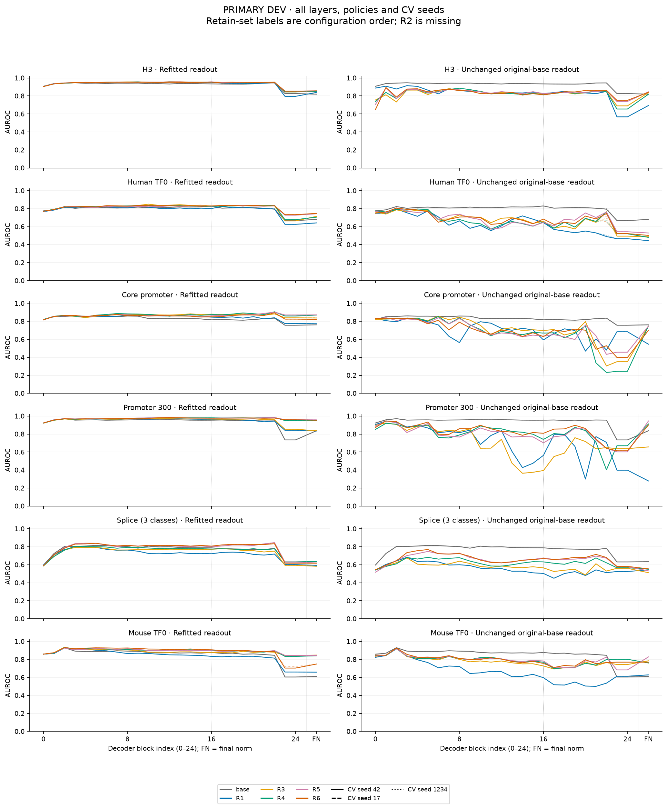

## profiles_dev_average_precision

Every line is a released checkpoint/readout at one CV seed. Seed styles are not confidence bands or independently trained checkpoints. No R2 trajectory or best-layer selection is drawn.

[PDF](figures/profiles_dev_average_precision.pdf) · [PNG](figures/profiles_dev_average_precision.png) · [SVG](figures/profiles_dev_average_precision.svg) · [plotted rows](figures/data/profiles_dev_average_precision.csv)

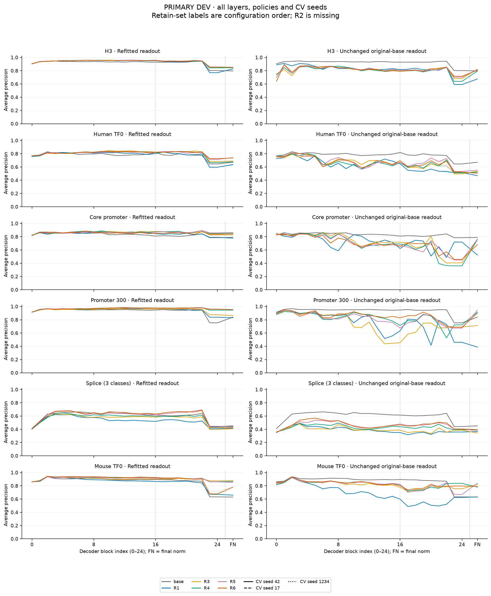

## profiles_dev_accuracy

Every line is a released checkpoint/readout at one CV seed. Seed styles are not confidence bands or independently trained checkpoints. No R2 trajectory or best-layer selection is drawn.

[PDF](figures/profiles_dev_accuracy.pdf) · [PNG](figures/profiles_dev_accuracy.png) · [SVG](figures/profiles_dev_accuracy.svg) · [plotted rows](figures/data/profiles_dev_accuracy.csv)

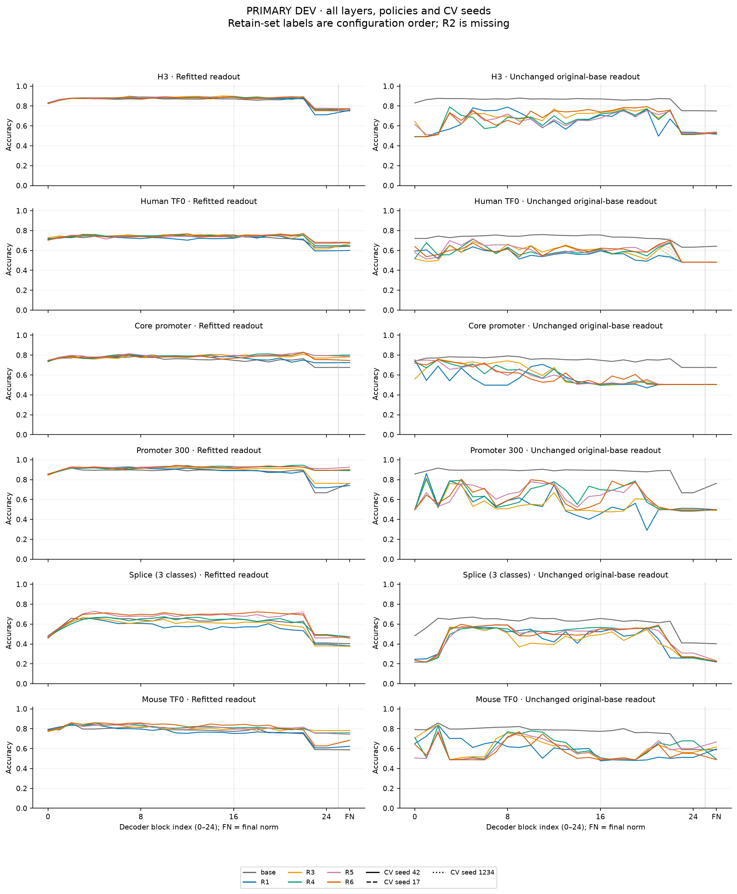

## profiles_dev_balanced_accuracy

Every line is a released checkpoint/readout at one CV seed. Seed styles are not confidence bands or independently trained checkpoints. No R2 trajectory or best-layer selection is drawn.

[PDF](figures/profiles_dev_balanced_accuracy.pdf) · [PNG](figures/profiles_dev_balanced_accuracy.png) · [SVG](figures/profiles_dev_balanced_accuracy.svg) · [plotted rows](figures/data/profiles_dev_balanced_accuracy.csv)

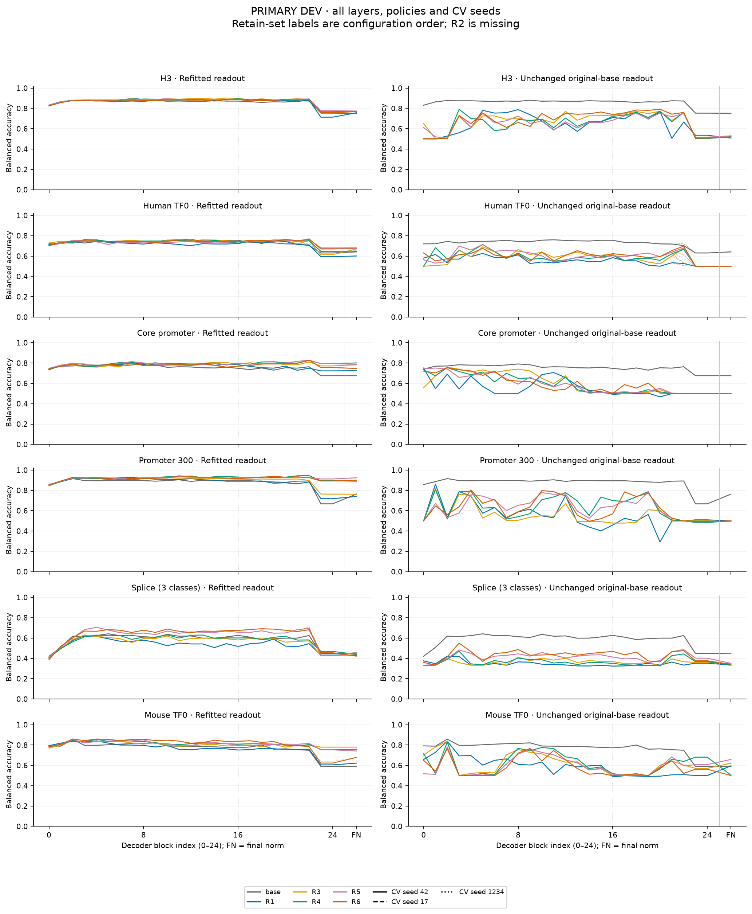

## profiles_dev_classification_cross_entropy

Every line is a released checkpoint/readout at one CV seed. Seed styles are not confidence bands or independently trained checkpoints. No R2 trajectory or best-layer selection is drawn.

[PDF](figures/profiles_dev_classification_cross_entropy.pdf) · [PNG](figures/profiles_dev_classification_cross_entropy.png) · [SVG](figures/profiles_dev_classification_cross_entropy.svg) · [plotted rows](figures/data/profiles_dev_classification_cross_entropy.csv)

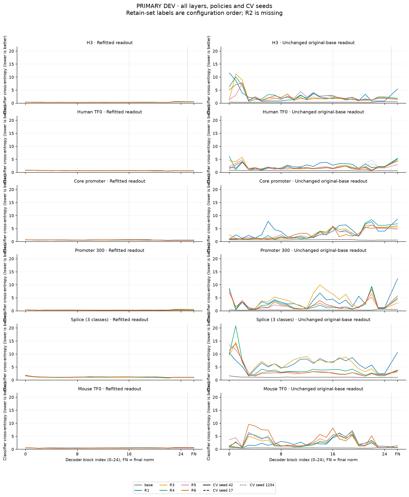

## profiles_exploratory_H3_auroc

Every line is a released checkpoint/readout at one CV seed. Seed styles are not confidence bands or independently trained checkpoints. No R2 trajectory or best-layer selection is drawn.

[PDF](figures/profiles_exploratory_H3_auroc.pdf) · [PNG](figures/profiles_exploratory_H3_auroc.png) · [SVG](figures/profiles_exploratory_H3_auroc.svg) · [plotted rows](figures/data/profiles_exploratory_H3_auroc.csv)

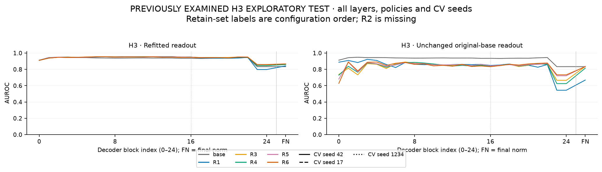

## coverage_map

Each released task cell contains26 representations×3 CV seeds. H3 test adds reporting records, not additional fitted heads. R2 missingness is not a zero performance score.

[PDF](figures/coverage_map.pdf) · [PNG](figures/coverage_map.png) · [SVG](figures/coverage_map.svg) · [plotted rows](figures/data/coverage_map.csv)

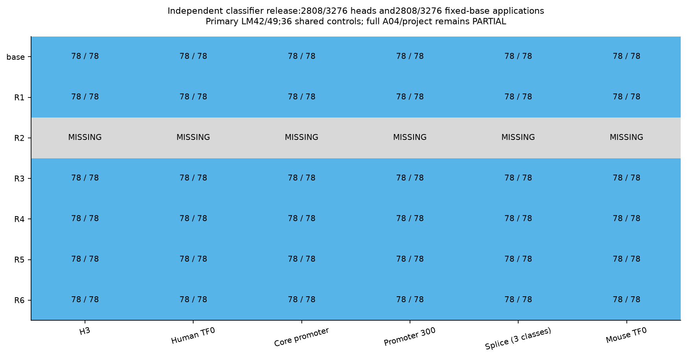

## task_entry_declarations

Declaration colors reflect supplied configuration evidence only. Missing R2 is unknown, not absence; no biological or training-exposure inference is made.

[PDF](figures/task_entry_declarations.pdf) · [PNG](figures/task_entry_declarations.png) · [SVG](figures/task_entry_declarations.svg) · [plotted rows](figures/data/task_entry_declarations.csv)

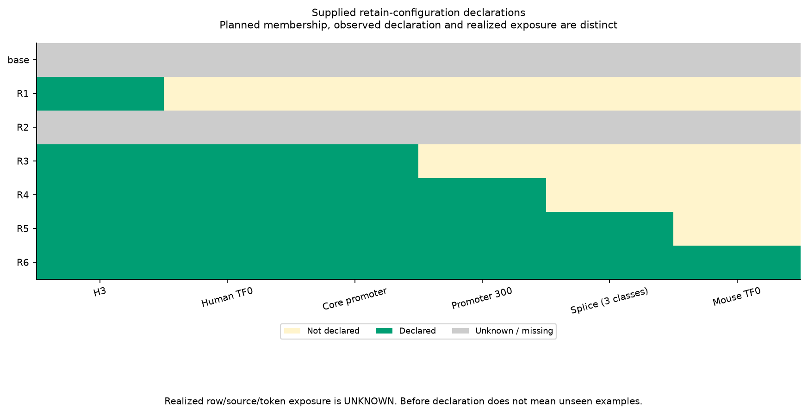

## adjacent_anchor_AUROC

Dots are point estimates; vertical lines are pointwise exploratory unadjusted95% saved-group-bootstrap intervals conditional on fitted heads. Every anchor/CV seed/policy is shown; intervals crossing zero are inconclusive. R2-dependent edges remain missing.

[PDF](figures/adjacent_anchor_AUROC.pdf) · [PNG](figures/adjacent_anchor_AUROC.png) · [SVG](figures/adjacent_anchor_AUROC.svg) · [plotted rows](figures/data/adjacent_anchor_AUROC.csv)

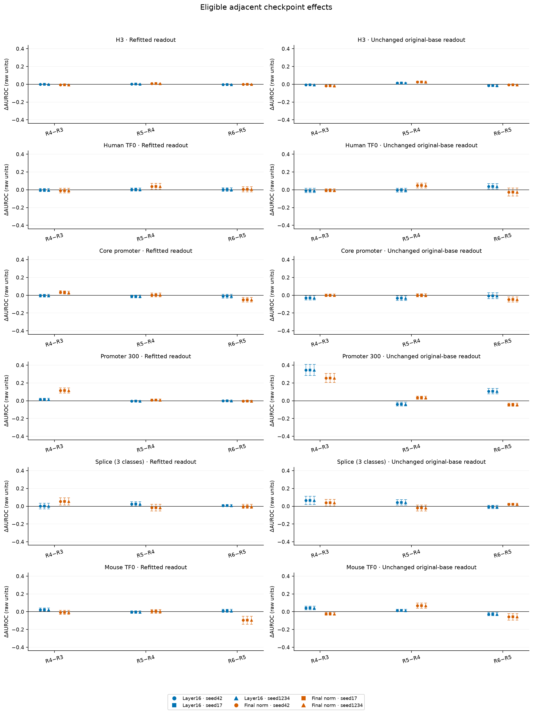

## R5_matched_reference_AUROC

Dots are point estimates; vertical lines are pointwise exploratory unadjusted95% saved-group-bootstrap intervals conditional on fitted heads. Every anchor/CV seed/policy is shown; intervals crossing zero are inconclusive. R2-dependent edges remain missing.

[PDF](figures/R5_matched_reference_AUROC.pdf) · [PNG](figures/R5_matched_reference_AUROC.png) · [SVG](figures/R5_matched_reference_AUROC.svg) · [plotted rows](figures/data/R5_matched_reference_AUROC.csv)

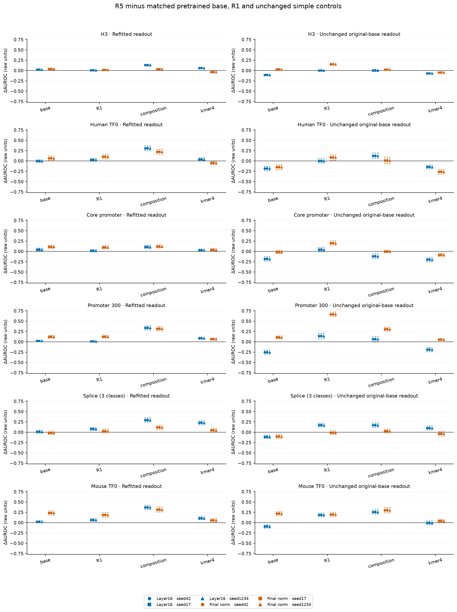

## LM_primary_dev

Corpus NLL is summed saved causal loss divided by valid targets; PPL is exp(corpus NLL). Within-task paired group-bootstrap intervals; no layer/CV axis or cross-task capability average.

[PDF](figures/LM_primary_dev.pdf) · [PNG](figures/LM_primary_dev.png) · [SVG](figures/LM_primary_dev.svg) · [plotted rows](figures/data/LM_primary_dev.csv)

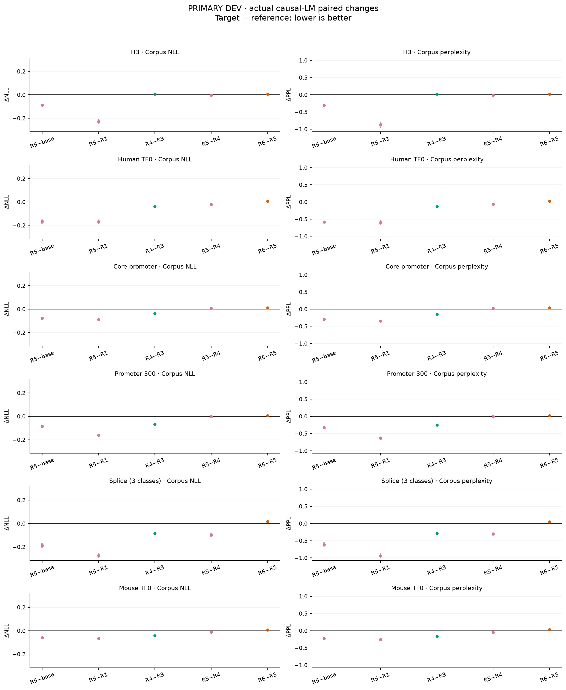

## LM_exploratory_H3_test

Corpus NLL is summed saved causal loss divided by valid targets; PPL is exp(corpus NLL). Within-task paired group-bootstrap intervals; no layer/CV axis or cross-task capability average.

[PDF](figures/LM_exploratory_H3_test.pdf) · [PNG](figures/LM_exploratory_H3_test.png) · [SVG](figures/LM_exploratory_H3_test.svg) · [plotted rows](figures/data/LM_exploratory_H3_test.csv)

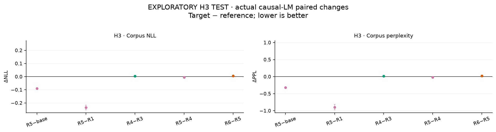
