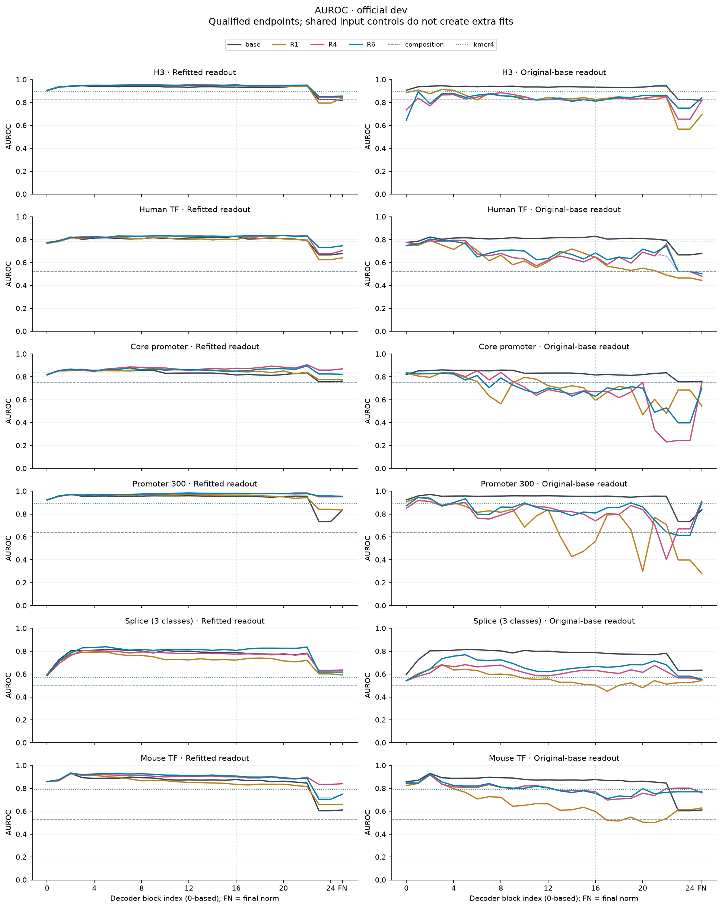
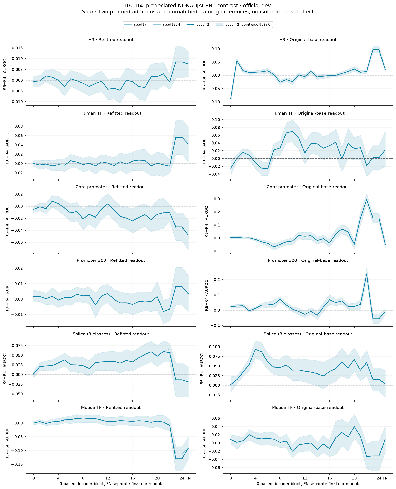
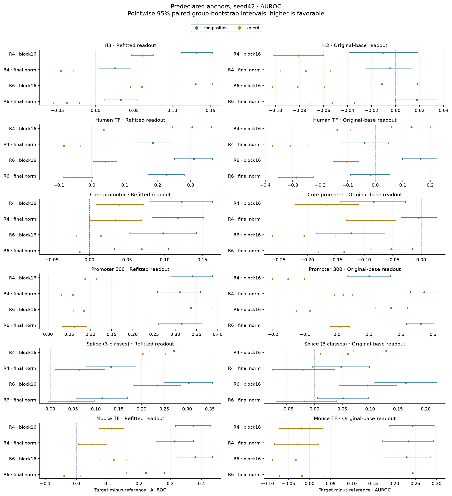
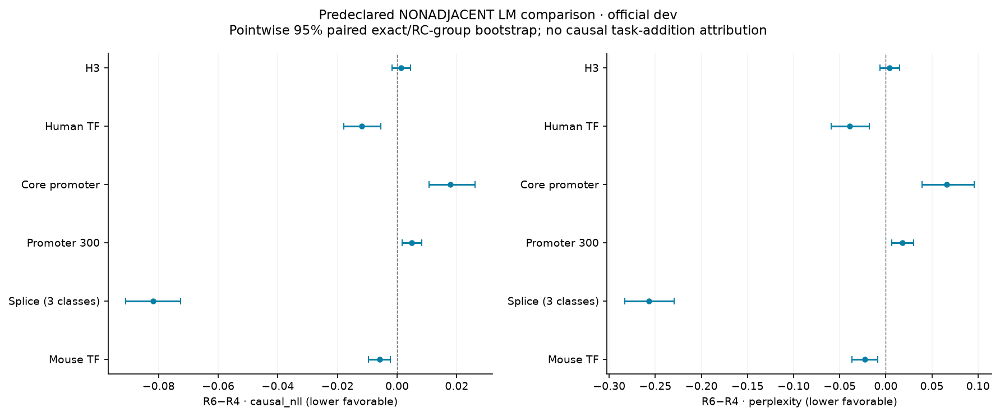
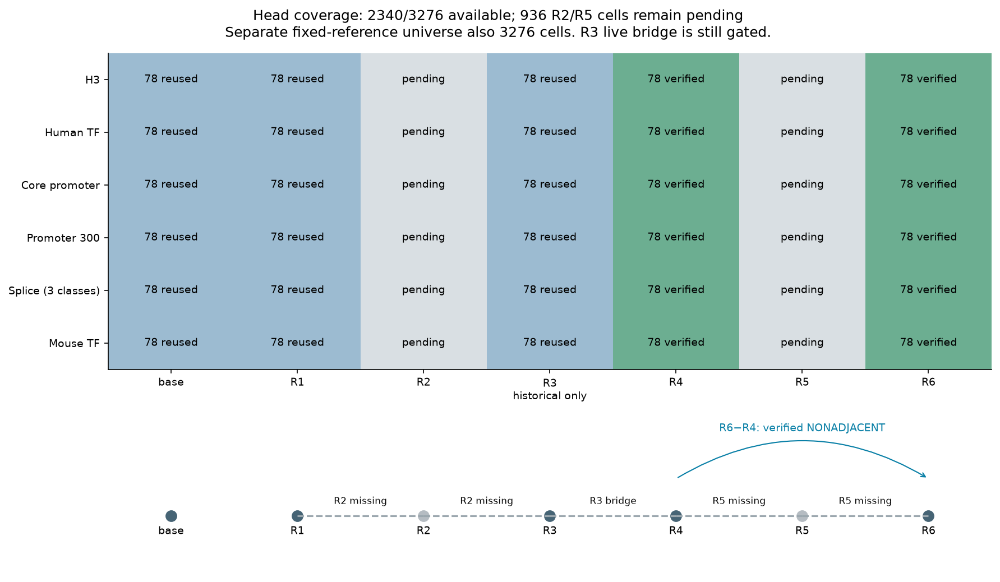

# Verified figure gallery

All 31 PNG/PDF pairs are reused byte-identically from the pinned A08 commit. Full-precision values and all panel uses are in [plot data](../A08-attempt-001/PLOT_DATA/plotted_values.csv); [figure validation](../A08-attempt-001/FIGURE_VALIDATION.json) records data/source/file hashes and captions. No rerendering, smoothing, new interval family or best-layer selection was performed. Bold curves display seed 42; thin curves retain seeds 17/1234. Seed spread is not a CI; shaded intervals are conditional pointwise bootstrap intervals. Final norm is a separate hook.

## Dev

Official dev only. R6−R4 is explicitly nonadjacent; all-layer controls are point displays while paired control inference stays at the predeclared anchors.

| Figure | PNG | PDF | Scope / caption |
|---|---|---|---|
| dev/profiles_auroc | [View](../A08-attempt-001/figures/dev/profiles_auroc.png) | [Download](../A08-attempt-001/figures/dev/profiles_auroc.pdf) | All 26 representations and 3 CV seeds. Bold seed 42; thin 17/1234. Seed spread is not a confidence band. Layer16 is the 17th block. Horizontal shared controls are point displays; paired control inference remains limited to predeclared anchors. Qualified endpoints; shared input controls do not create extra fits |
| dev/anchors_auroc | [View](../A08-attempt-001/figures/dev/anchors_auroc.png) | [Download](../A08-attempt-001/figures/dev/anchors_auroc.pdf) | Seed 42 and layer 16/final norm were predeclared, not selected using scores. Intervals are conditional on fitted heads and unadjusted across the grid; all seeds remain in released tables. |
| dev/R6_minus_R4_auroc | [View](../A08-attempt-001/figures/dev/R6_minus_R4_auroc.png) | [Download](../A08-attempt-001/figures/dev/R6_minus_R4_auroc.pdf) | All 26 hooks and 3 seeds shown. Shading is seed 42 pointwise bootstrap CI, not seed spread or a simultaneous band. R6−R4 is nonadjacent and cannot replace missing adjacent edges. |
| dev/profiles_average_precision | [View](../A08-attempt-001/figures/dev/profiles_average_precision.png) | [Download](../A08-attempt-001/figures/dev/profiles_average_precision.pdf) | All 26 representations and 3 CV seeds. Bold seed 42; thin 17/1234. Seed spread is not a confidence band. Layer16 is the 17th block. Horizontal shared controls are point displays; paired control inference remains limited to predeclared anchors. Qualified endpoints; shared input controls do not create extra fits |
| dev/anchors_average_precision | [View](../A08-attempt-001/figures/dev/anchors_average_precision.png) | [Download](../A08-attempt-001/figures/dev/anchors_average_precision.pdf) | Seed 42 and layer 16/final norm were predeclared, not selected using scores. Intervals are conditional on fitted heads and unadjusted across the grid; all seeds remain in released tables. |
| dev/R6_minus_R4_average_precision | [View](../A08-attempt-001/figures/dev/R6_minus_R4_average_precision.png) | [Download](../A08-attempt-001/figures/dev/R6_minus_R4_average_precision.pdf) | All 26 hooks and 3 seeds shown. Shading is seed 42 pointwise bootstrap CI, not seed spread or a simultaneous band. R6−R4 is nonadjacent and cannot replace missing adjacent edges. |
| dev/profiles_accuracy | [View](../A08-attempt-001/figures/dev/profiles_accuracy.png) | [Download](../A08-attempt-001/figures/dev/profiles_accuracy.pdf) | All 26 representations and 3 CV seeds. Bold seed 42; thin 17/1234. Seed spread is not a confidence band. Layer16 is the 17th block. Horizontal shared controls are point displays; paired control inference remains limited to predeclared anchors. Qualified endpoints; shared input controls do not create extra fits |
| dev/anchors_accuracy | [View](../A08-attempt-001/figures/dev/anchors_accuracy.png) | [Download](../A08-attempt-001/figures/dev/anchors_accuracy.pdf) | Seed 42 and layer 16/final norm were predeclared, not selected using scores. Intervals are conditional on fitted heads and unadjusted across the grid; all seeds remain in released tables. |
| dev/R6_minus_R4_accuracy | [View](../A08-attempt-001/figures/dev/R6_minus_R4_accuracy.png) | [Download](../A08-attempt-001/figures/dev/R6_minus_R4_accuracy.pdf) | All 26 hooks and 3 seeds shown. Shading is seed 42 pointwise bootstrap CI, not seed spread or a simultaneous band. R6−R4 is nonadjacent and cannot replace missing adjacent edges. |
| dev/profiles_balanced_accuracy | [View](../A08-attempt-001/figures/dev/profiles_balanced_accuracy.png) | [Download](../A08-attempt-001/figures/dev/profiles_balanced_accuracy.pdf) | All 26 representations and 3 CV seeds. Bold seed 42; thin 17/1234. Seed spread is not a confidence band. Layer16 is the 17th block. Horizontal shared controls are point displays; paired control inference remains limited to predeclared anchors. Qualified endpoints; shared input controls do not create extra fits |
| dev/anchors_balanced_accuracy | [View](../A08-attempt-001/figures/dev/anchors_balanced_accuracy.png) | [Download](../A08-attempt-001/figures/dev/anchors_balanced_accuracy.pdf) | Seed 42 and layer 16/final norm were predeclared, not selected using scores. Intervals are conditional on fitted heads and unadjusted across the grid; all seeds remain in released tables. |
| dev/R6_minus_R4_balanced_accuracy | [View](../A08-attempt-001/figures/dev/R6_minus_R4_balanced_accuracy.png) | [Download](../A08-attempt-001/figures/dev/R6_minus_R4_balanced_accuracy.pdf) | All 26 hooks and 3 seeds shown. Shading is seed 42 pointwise bootstrap CI, not seed spread or a simultaneous band. R6−R4 is nonadjacent and cannot replace missing adjacent edges. |
| dev/profiles_classification_cross_entropy | [View](../A08-attempt-001/figures/dev/profiles_classification_cross_entropy.png) | [Download](../A08-attempt-001/figures/dev/profiles_classification_cross_entropy.pdf) | All 26 representations and 3 CV seeds. Bold seed 42; thin 17/1234. Seed spread is not a confidence band. Layer16 is the 17th block. Horizontal shared controls are point displays; paired control inference remains limited to predeclared anchors. Qualified endpoints; shared input controls do not create extra fits |
| dev/anchors_classification_cross_entropy | [View](../A08-attempt-001/figures/dev/anchors_classification_cross_entropy.png) | [Download](../A08-attempt-001/figures/dev/anchors_classification_cross_entropy.pdf) | Seed 42 and layer 16/final norm were predeclared, not selected using scores. Intervals are conditional on fitted heads and unadjusted across the grid; all seeds remain in released tables. |
| dev/R6_minus_R4_classification_cross_entropy | [View](../A08-attempt-001/figures/dev/R6_minus_R4_classification_cross_entropy.png) | [Download](../A08-attempt-001/figures/dev/R6_minus_R4_classification_cross_entropy.pdf) | All 26 hooks and 3 seeds shown. Shading is seed 42 pointwise bootstrap CI, not seed spread or a simultaneous band. R6−R4 is nonadjacent and cannot replace missing adjacent edges. |
| dev/anchors__controls_auroc | [View](../A08-attempt-001/figures/dev/anchors__controls_auroc.png) | [Download](../A08-attempt-001/figures/dev/anchors__controls_auroc.pdf) | Seed 42 and layer 16/final norm were predeclared, not selected using scores. Intervals are conditional on fitted heads and unadjusted across the grid; all seeds remain in released tables. |
| dev/LM_within_task | [View](../A08-attempt-001/figures/dev/LM_within_task.png) | [Download](../A08-attempt-001/figures/dev/LM_within_task.pdf) | Corpus NLL=sum(loss)/sum(targets); PPL=exp(NLL). Historical marginal CIs not present in inherited point tables; current R4/R6CIs reused. No averaging sequence perplexities or across-task capability score. |
| dev/LM_R6_minus_R4 | [View](../A08-attempt-001/figures/dev/LM_R6_minus_R4.png) | [Download](../A08-attempt-001/figures/dev/LM_R6_minus_R4.pdf) | No representation/CVseed axis; seven primary split units,14metrics for this new contrast family. Classification cross-entropy is a different output. |

## Exploratory Test

Previously examined H3 exploratory test, never pooled with dev or presented as untouched confirmation.

| Figure | PNG | PDF | Scope / caption |
|---|---|---|---|
| exploratory_test/profiles_auroc | [View](../A08-attempt-001/figures/exploratory_test/profiles_auroc.png) | [Download](../A08-attempt-001/figures/exploratory_test/profiles_auroc.pdf) | All 26 representations and 3 CV seeds. Bold seed 42; thin 17/1234. Seed spread is not a confidence band. Layer16 is the 17th block. Horizontal shared controls are point displays; paired control inference remains limited to predeclared anchors. Qualified endpoints; shared input controls do not create extra fits |
| exploratory_test/R6_minus_R4_auroc | [View](../A08-attempt-001/figures/exploratory_test/R6_minus_R4_auroc.png) | [Download](../A08-attempt-001/figures/exploratory_test/R6_minus_R4_auroc.pdf) | All 26 hooks and 3 seeds shown. Shading is seed 42 pointwise bootstrap CI, not seed spread or a simultaneous band. R6−R4 is nonadjacent and cannot replace missing adjacent edges. |
| exploratory_test/profiles_average_precision | [View](../A08-attempt-001/figures/exploratory_test/profiles_average_precision.png) | [Download](../A08-attempt-001/figures/exploratory_test/profiles_average_precision.pdf) | All 26 representations and 3 CV seeds. Bold seed 42; thin 17/1234. Seed spread is not a confidence band. Layer16 is the 17th block. Horizontal shared controls are point displays; paired control inference remains limited to predeclared anchors. Qualified endpoints; shared input controls do not create extra fits |
| exploratory_test/R6_minus_R4_average_precision | [View](../A08-attempt-001/figures/exploratory_test/R6_minus_R4_average_precision.png) | [Download](../A08-attempt-001/figures/exploratory_test/R6_minus_R4_average_precision.pdf) | All 26 hooks and 3 seeds shown. Shading is seed 42 pointwise bootstrap CI, not seed spread or a simultaneous band. R6−R4 is nonadjacent and cannot replace missing adjacent edges. |
| exploratory_test/profiles_accuracy | [View](../A08-attempt-001/figures/exploratory_test/profiles_accuracy.png) | [Download](../A08-attempt-001/figures/exploratory_test/profiles_accuracy.pdf) | All 26 representations and 3 CV seeds. Bold seed 42; thin 17/1234. Seed spread is not a confidence band. Layer16 is the 17th block. Horizontal shared controls are point displays; paired control inference remains limited to predeclared anchors. Qualified endpoints; shared input controls do not create extra fits |
| exploratory_test/R6_minus_R4_accuracy | [View](../A08-attempt-001/figures/exploratory_test/R6_minus_R4_accuracy.png) | [Download](../A08-attempt-001/figures/exploratory_test/R6_minus_R4_accuracy.pdf) | All 26 hooks and 3 seeds shown. Shading is seed 42 pointwise bootstrap CI, not seed spread or a simultaneous band. R6−R4 is nonadjacent and cannot replace missing adjacent edges. |
| exploratory_test/profiles_balanced_accuracy | [View](../A08-attempt-001/figures/exploratory_test/profiles_balanced_accuracy.png) | [Download](../A08-attempt-001/figures/exploratory_test/profiles_balanced_accuracy.pdf) | All 26 representations and 3 CV seeds. Bold seed 42; thin 17/1234. Seed spread is not a confidence band. Layer16 is the 17th block. Horizontal shared controls are point displays; paired control inference remains limited to predeclared anchors. Qualified endpoints; shared input controls do not create extra fits |
| exploratory_test/R6_minus_R4_balanced_accuracy | [View](../A08-attempt-001/figures/exploratory_test/R6_minus_R4_balanced_accuracy.png) | [Download](../A08-attempt-001/figures/exploratory_test/R6_minus_R4_balanced_accuracy.pdf) | All 26 hooks and 3 seeds shown. Shading is seed 42 pointwise bootstrap CI, not seed spread or a simultaneous band. R6−R4 is nonadjacent and cannot replace missing adjacent edges. |
| exploratory_test/profiles_classification_cross_entropy | [View](../A08-attempt-001/figures/exploratory_test/profiles_classification_cross_entropy.png) | [Download](../A08-attempt-001/figures/exploratory_test/profiles_classification_cross_entropy.pdf) | All 26 representations and 3 CV seeds. Bold seed 42; thin 17/1234. Seed spread is not a confidence band. Layer16 is the 17th block. Horizontal shared controls are point displays; paired control inference remains limited to predeclared anchors. Qualified endpoints; shared input controls do not create extra fits |
| exploratory_test/R6_minus_R4_classification_cross_entropy | [View](../A08-attempt-001/figures/exploratory_test/R6_minus_R4_classification_cross_entropy.png) | [Download](../A08-attempt-001/figures/exploratory_test/R6_minus_R4_classification_cross_entropy.pdf) | All 26 hooks and 3 seeds shown. Shading is seed 42 pointwise bootstrap CI, not seed spread or a simultaneous band. R6−R4 is nonadjacent and cannot replace missing adjacent edges. |
| exploratory_test/LM_R6_minus_R4 | [View](../A08-attempt-001/figures/exploratory_test/LM_R6_minus_R4.png) | [Download](../A08-attempt-001/figures/exploratory_test/LM_R6_minus_R4.pdf) | No representation/CVseed axis; seven primary split units,14metrics for this new contrast family. Classification cross-entropy is a different output. |

## Historical Domain

Historical R3/base/R1 domain only; no line bridges it into current R4/R6 effects.

| Figure | PNG | PDF | Scope / caption |
|---|---|---|---|
| historical_domain/profiles_auroc | [View](../A08-attempt-001/figures/historical_domain/profiles_auroc.png) | [Download](../A08-attempt-001/figures/historical_domain/profiles_auroc.pdf) | All 26 representations and 3 CV seeds. Bold seed 42; thin 17/1234. Seed spread is not a confidence band. Layer16 is the 17th block. Horizontal shared controls are point displays; paired control inference remains limited to predeclared anchors. Historical domain only: base/R1/R3; no bridge to current R4/R6 effects |

## Coverage

Missing endpoints and adjacent edges stay visible; no filled-in trajectory.

| Figure | PNG | PDF | Scope / caption |
|---|---|---|---|
| coverage/availability_and_missing_edges | [View](../A08-attempt-001/figures/coverage/availability_and_missing_edges.png) | [Download](../A08-attempt-001/figures/coverage/availability_and_missing_edges.pdf) | Each colored task/endpoint cell represents26 representations x 3 seeds. A04 remains PARTIAL; no full-project completion or inferred trajectory through missing stages. |

### dev/profiles auroc

### dev/R6 minus R4 auroc

### dev/anchors  controls auroc

### dev/LM R6 minus R4

### coverage/availability and missing edges

