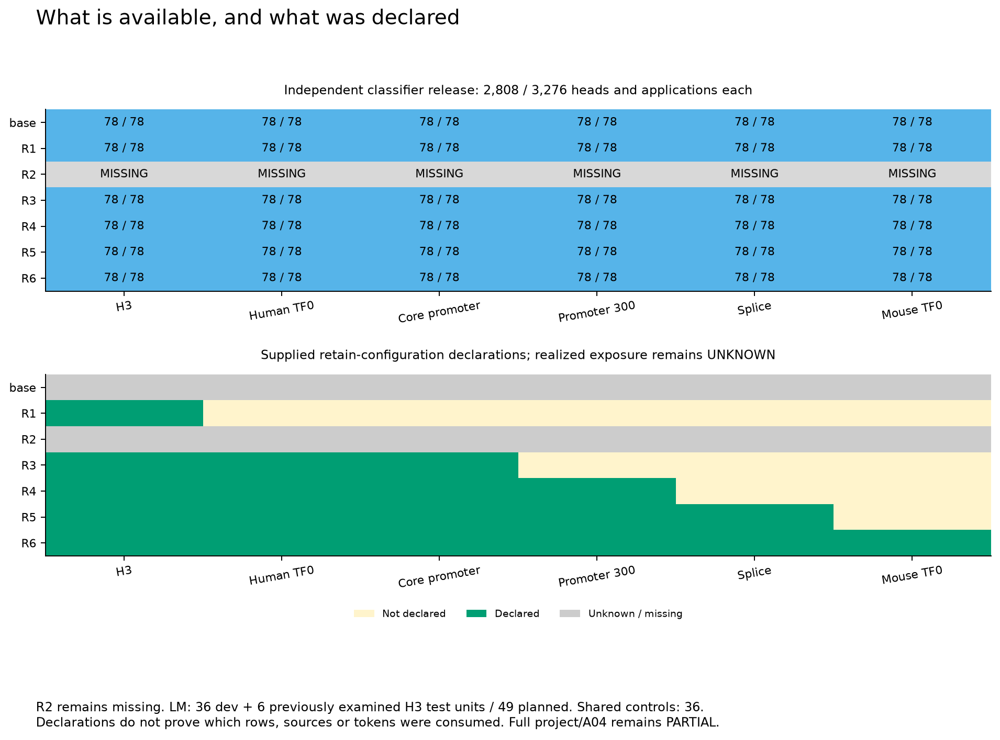
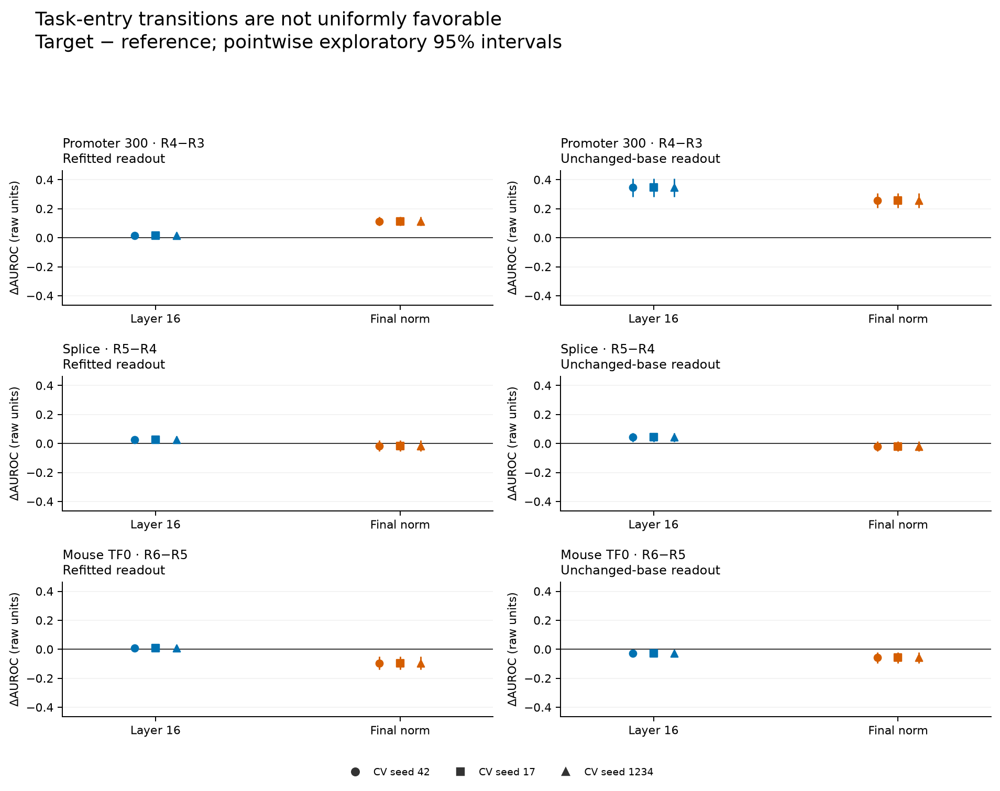
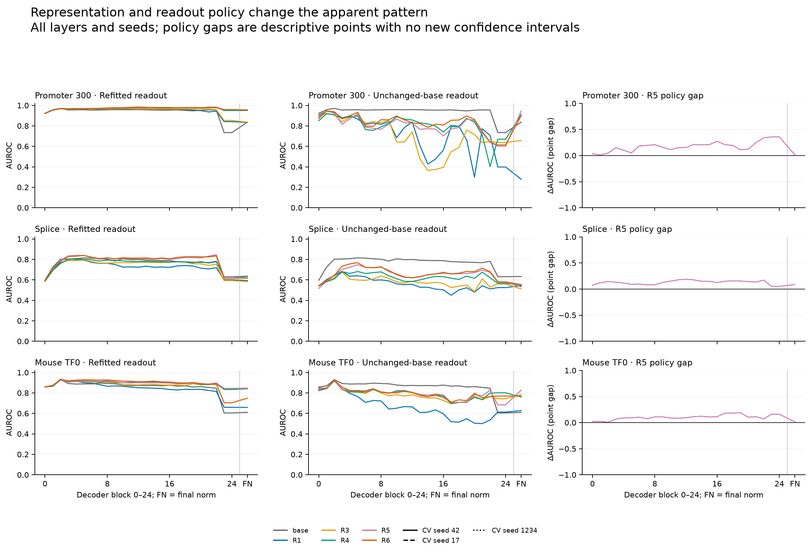
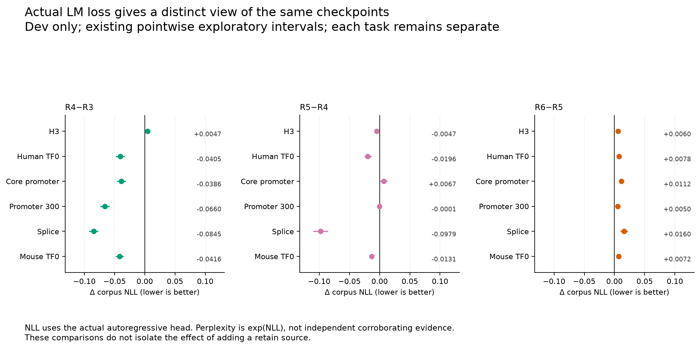

# Main figures and exhaustive inherited appendix

Four main families summarize the released evidence. All CSVs retain full precision. Existing intervals remain pointwise exploratory and conditional on fitted heads.

## main_coverage

Coverage and declarations are separate evidence. Gray is missing or unknown, never a zero performance score. Before declaration does not mean unseen examples.

[PDF](figures/main_coverage.pdf) · [PNG](figures/main_coverage.png) · [SVG](figures/main_coverage.svg) · [Source CSV](figures/data/main_coverage.csv)

## main_task_entry

Both predeclared anchors, policies and all three CV seeds are shown. Intervals are unadjusted and conditional on fitted heads; overlapping identical seed results are not independent training replications.

[PDF](figures/main_task_entry.pdf) · [PNG](figures/main_task_entry.png) · [SVG](figures/main_task_entry.svg) · [Source CSV](figures/data/main_task_entry.csv)

## main_profiles_policy

All three task-entry tasks; all six available checkpoints,26 representations and three CV seeds. R5 policy-gap curves subtract matched point estimates only. Full six-task profiles are in the inherited appendix.

[PDF](figures/main_profiles_policy.pdf) · [PNG](figures/main_profiles_policy.png) · [SVG](figures/main_profiles_policy.svg) · [Source CSV](figures/data/main_profiles_policy.csv)

## main_LM_adjacent

All six tasks and three eligible adjacent transitions. Lower NLL is favorable. No pooled task-capability score, new LM evaluation or new confidence-interval family.

[PDF](figures/main_LM_adjacent.pdf) · [PNG](figures/main_LM_adjacent.png) · [SVG](figures/main_LM_adjacent.svg) · [Source CSV](figures/data/main_LM_adjacent.csv)

## Full six-task A08 appendix

The12 existing families retain all tasks,layers,seeds,policies,controls,LM and separate previously examined H3 test. These assets are reused at immutable Git/private identities and were not rerendered.

- **profiles_dev_auroc**: [PDF](https://github.com/Georgakopoulos-Soares-lab/unlearning/blob/5eed0985d84c6f2d925a6700baaac3efd6d27426/docs/experiments/ashay/POD_A/20261117T084728Z-a01/attempts/A08-attempt-002/figures/profiles_dev_auroc.pdf) · [PNG](https://github.com/Georgakopoulos-Soares-lab/unlearning/blob/5eed0985d84c6f2d925a6700baaac3efd6d27426/docs/experiments/ashay/POD_A/20261117T084728Z-a01/attempts/A08-attempt-002/figures/profiles_dev_auroc.png) · [SVG](https://github.com/Georgakopoulos-Soares-lab/unlearning/blob/5eed0985d84c6f2d925a6700baaac3efd6d27426/docs/experiments/ashay/POD_A/20261117T084728Z-a01/attempts/A08-attempt-002/figures/profiles_dev_auroc.svg) · [Full-precision rows](https://github.com/Georgakopoulos-Soares-lab/unlearning/blob/5eed0985d84c6f2d925a6700baaac3efd6d27426/docs/experiments/ashay/POD_A/20261117T084728Z-a01/attempts/A08-attempt-002/figures/data/profiles_dev_auroc.csv).
- **profiles_dev_average_precision**: [PDF](https://github.com/Georgakopoulos-Soares-lab/unlearning/blob/5eed0985d84c6f2d925a6700baaac3efd6d27426/docs/experiments/ashay/POD_A/20261117T084728Z-a01/attempts/A08-attempt-002/figures/profiles_dev_average_precision.pdf) · [PNG](https://github.com/Georgakopoulos-Soares-lab/unlearning/blob/5eed0985d84c6f2d925a6700baaac3efd6d27426/docs/experiments/ashay/POD_A/20261117T084728Z-a01/attempts/A08-attempt-002/figures/profiles_dev_average_precision.png) · [SVG](https://github.com/Georgakopoulos-Soares-lab/unlearning/blob/5eed0985d84c6f2d925a6700baaac3efd6d27426/docs/experiments/ashay/POD_A/20261117T084728Z-a01/attempts/A08-attempt-002/figures/profiles_dev_average_precision.svg) · [Full-precision rows](https://github.com/Georgakopoulos-Soares-lab/unlearning/blob/5eed0985d84c6f2d925a6700baaac3efd6d27426/docs/experiments/ashay/POD_A/20261117T084728Z-a01/attempts/A08-attempt-002/figures/data/profiles_dev_average_precision.csv).
- **profiles_dev_accuracy**: [PDF](https://github.com/Georgakopoulos-Soares-lab/unlearning/blob/5eed0985d84c6f2d925a6700baaac3efd6d27426/docs/experiments/ashay/POD_A/20261117T084728Z-a01/attempts/A08-attempt-002/figures/profiles_dev_accuracy.pdf) · [PNG](https://github.com/Georgakopoulos-Soares-lab/unlearning/blob/5eed0985d84c6f2d925a6700baaac3efd6d27426/docs/experiments/ashay/POD_A/20261117T084728Z-a01/attempts/A08-attempt-002/figures/profiles_dev_accuracy.png) · [SVG](https://github.com/Georgakopoulos-Soares-lab/unlearning/blob/5eed0985d84c6f2d925a6700baaac3efd6d27426/docs/experiments/ashay/POD_A/20261117T084728Z-a01/attempts/A08-attempt-002/figures/profiles_dev_accuracy.svg) · [Full-precision rows](https://github.com/Georgakopoulos-Soares-lab/unlearning/blob/5eed0985d84c6f2d925a6700baaac3efd6d27426/docs/experiments/ashay/POD_A/20261117T084728Z-a01/attempts/A08-attempt-002/figures/data/profiles_dev_accuracy.csv).
- **profiles_dev_balanced_accuracy**: [PDF](https://github.com/Georgakopoulos-Soares-lab/unlearning/blob/5eed0985d84c6f2d925a6700baaac3efd6d27426/docs/experiments/ashay/POD_A/20261117T084728Z-a01/attempts/A08-attempt-002/figures/profiles_dev_balanced_accuracy.pdf) · [PNG](https://github.com/Georgakopoulos-Soares-lab/unlearning/blob/5eed0985d84c6f2d925a6700baaac3efd6d27426/docs/experiments/ashay/POD_A/20261117T084728Z-a01/attempts/A08-attempt-002/figures/profiles_dev_balanced_accuracy.png) · [SVG](https://github.com/Georgakopoulos-Soares-lab/unlearning/blob/5eed0985d84c6f2d925a6700baaac3efd6d27426/docs/experiments/ashay/POD_A/20261117T084728Z-a01/attempts/A08-attempt-002/figures/profiles_dev_balanced_accuracy.svg) · [Full-precision rows](https://github.com/Georgakopoulos-Soares-lab/unlearning/blob/5eed0985d84c6f2d925a6700baaac3efd6d27426/docs/experiments/ashay/POD_A/20261117T084728Z-a01/attempts/A08-attempt-002/figures/data/profiles_dev_balanced_accuracy.csv).
- **profiles_dev_classification_cross_entropy**: [PDF](https://github.com/Georgakopoulos-Soares-lab/unlearning/blob/5eed0985d84c6f2d925a6700baaac3efd6d27426/docs/experiments/ashay/POD_A/20261117T084728Z-a01/attempts/A08-attempt-002/figures/profiles_dev_classification_cross_entropy.pdf) · [PNG](https://github.com/Georgakopoulos-Soares-lab/unlearning/blob/5eed0985d84c6f2d925a6700baaac3efd6d27426/docs/experiments/ashay/POD_A/20261117T084728Z-a01/attempts/A08-attempt-002/figures/profiles_dev_classification_cross_entropy.png) · [SVG](https://github.com/Georgakopoulos-Soares-lab/unlearning/blob/5eed0985d84c6f2d925a6700baaac3efd6d27426/docs/experiments/ashay/POD_A/20261117T084728Z-a01/attempts/A08-attempt-002/figures/profiles_dev_classification_cross_entropy.svg) · [Full-precision rows](https://github.com/Georgakopoulos-Soares-lab/unlearning/blob/5eed0985d84c6f2d925a6700baaac3efd6d27426/docs/experiments/ashay/POD_A/20261117T084728Z-a01/attempts/A08-attempt-002/figures/data/profiles_dev_classification_cross_entropy.csv).
- **profiles_exploratory_H3_auroc**: [PDF](https://github.com/Georgakopoulos-Soares-lab/unlearning/blob/5eed0985d84c6f2d925a6700baaac3efd6d27426/docs/experiments/ashay/POD_A/20261117T084728Z-a01/attempts/A08-attempt-002/figures/profiles_exploratory_H3_auroc.pdf) · [PNG](https://github.com/Georgakopoulos-Soares-lab/unlearning/blob/5eed0985d84c6f2d925a6700baaac3efd6d27426/docs/experiments/ashay/POD_A/20261117T084728Z-a01/attempts/A08-attempt-002/figures/profiles_exploratory_H3_auroc.png) · [SVG](https://github.com/Georgakopoulos-Soares-lab/unlearning/blob/5eed0985d84c6f2d925a6700baaac3efd6d27426/docs/experiments/ashay/POD_A/20261117T084728Z-a01/attempts/A08-attempt-002/figures/profiles_exploratory_H3_auroc.svg) · [Full-precision rows](https://github.com/Georgakopoulos-Soares-lab/unlearning/blob/5eed0985d84c6f2d925a6700baaac3efd6d27426/docs/experiments/ashay/POD_A/20261117T084728Z-a01/attempts/A08-attempt-002/figures/data/profiles_exploratory_H3_auroc.csv).
- **coverage_map**: [PDF](https://github.com/Georgakopoulos-Soares-lab/unlearning/blob/5eed0985d84c6f2d925a6700baaac3efd6d27426/docs/experiments/ashay/POD_A/20261117T084728Z-a01/attempts/A08-attempt-002/figures/coverage_map.pdf) · [PNG](https://github.com/Georgakopoulos-Soares-lab/unlearning/blob/5eed0985d84c6f2d925a6700baaac3efd6d27426/docs/experiments/ashay/POD_A/20261117T084728Z-a01/attempts/A08-attempt-002/figures/coverage_map.png) · [SVG](https://github.com/Georgakopoulos-Soares-lab/unlearning/blob/5eed0985d84c6f2d925a6700baaac3efd6d27426/docs/experiments/ashay/POD_A/20261117T084728Z-a01/attempts/A08-attempt-002/figures/coverage_map.svg) · [Full-precision rows](https://github.com/Georgakopoulos-Soares-lab/unlearning/blob/5eed0985d84c6f2d925a6700baaac3efd6d27426/docs/experiments/ashay/POD_A/20261117T084728Z-a01/attempts/A08-attempt-002/figures/data/coverage_map.csv).
- **task_entry_declarations**: [PDF](https://github.com/Georgakopoulos-Soares-lab/unlearning/blob/5eed0985d84c6f2d925a6700baaac3efd6d27426/docs/experiments/ashay/POD_A/20261117T084728Z-a01/attempts/A08-attempt-002/figures/task_entry_declarations.pdf) · [PNG](https://github.com/Georgakopoulos-Soares-lab/unlearning/blob/5eed0985d84c6f2d925a6700baaac3efd6d27426/docs/experiments/ashay/POD_A/20261117T084728Z-a01/attempts/A08-attempt-002/figures/task_entry_declarations.png) · [SVG](https://github.com/Georgakopoulos-Soares-lab/unlearning/blob/5eed0985d84c6f2d925a6700baaac3efd6d27426/docs/experiments/ashay/POD_A/20261117T084728Z-a01/attempts/A08-attempt-002/figures/task_entry_declarations.svg) · [Full-precision rows](https://github.com/Georgakopoulos-Soares-lab/unlearning/blob/5eed0985d84c6f2d925a6700baaac3efd6d27426/docs/experiments/ashay/POD_A/20261117T084728Z-a01/attempts/A08-attempt-002/figures/data/task_entry_declarations.csv).
- **adjacent_anchor_AUROC**: [PDF](https://github.com/Georgakopoulos-Soares-lab/unlearning/blob/5eed0985d84c6f2d925a6700baaac3efd6d27426/docs/experiments/ashay/POD_A/20261117T084728Z-a01/attempts/A08-attempt-002/figures/adjacent_anchor_AUROC.pdf) · [PNG](https://github.com/Georgakopoulos-Soares-lab/unlearning/blob/5eed0985d84c6f2d925a6700baaac3efd6d27426/docs/experiments/ashay/POD_A/20261117T084728Z-a01/attempts/A08-attempt-002/figures/adjacent_anchor_AUROC.png) · [SVG](https://github.com/Georgakopoulos-Soares-lab/unlearning/blob/5eed0985d84c6f2d925a6700baaac3efd6d27426/docs/experiments/ashay/POD_A/20261117T084728Z-a01/attempts/A08-attempt-002/figures/adjacent_anchor_AUROC.svg) · [Full-precision rows](https://github.com/Georgakopoulos-Soares-lab/unlearning/blob/5eed0985d84c6f2d925a6700baaac3efd6d27426/docs/experiments/ashay/POD_A/20261117T084728Z-a01/attempts/A08-attempt-002/figures/data/adjacent_anchor_AUROC.csv).
- **R5_matched_reference_AUROC**: [PDF](https://github.com/Georgakopoulos-Soares-lab/unlearning/blob/5eed0985d84c6f2d925a6700baaac3efd6d27426/docs/experiments/ashay/POD_A/20261117T084728Z-a01/attempts/A08-attempt-002/figures/R5_matched_reference_AUROC.pdf) · [PNG](https://github.com/Georgakopoulos-Soares-lab/unlearning/blob/5eed0985d84c6f2d925a6700baaac3efd6d27426/docs/experiments/ashay/POD_A/20261117T084728Z-a01/attempts/A08-attempt-002/figures/R5_matched_reference_AUROC.png) · [SVG](https://github.com/Georgakopoulos-Soares-lab/unlearning/blob/5eed0985d84c6f2d925a6700baaac3efd6d27426/docs/experiments/ashay/POD_A/20261117T084728Z-a01/attempts/A08-attempt-002/figures/R5_matched_reference_AUROC.svg) · [Full-precision rows](https://github.com/Georgakopoulos-Soares-lab/unlearning/blob/5eed0985d84c6f2d925a6700baaac3efd6d27426/docs/experiments/ashay/POD_A/20261117T084728Z-a01/attempts/A08-attempt-002/figures/data/R5_matched_reference_AUROC.csv).
- **LM_primary_dev**: [PDF](https://github.com/Georgakopoulos-Soares-lab/unlearning/blob/5eed0985d84c6f2d925a6700baaac3efd6d27426/docs/experiments/ashay/POD_A/20261117T084728Z-a01/attempts/A08-attempt-002/figures/LM_primary_dev.pdf) · [PNG](https://github.com/Georgakopoulos-Soares-lab/unlearning/blob/5eed0985d84c6f2d925a6700baaac3efd6d27426/docs/experiments/ashay/POD_A/20261117T084728Z-a01/attempts/A08-attempt-002/figures/LM_primary_dev.png) · [SVG](https://github.com/Georgakopoulos-Soares-lab/unlearning/blob/5eed0985d84c6f2d925a6700baaac3efd6d27426/docs/experiments/ashay/POD_A/20261117T084728Z-a01/attempts/A08-attempt-002/figures/LM_primary_dev.svg) · [Full-precision rows](https://github.com/Georgakopoulos-Soares-lab/unlearning/blob/5eed0985d84c6f2d925a6700baaac3efd6d27426/docs/experiments/ashay/POD_A/20261117T084728Z-a01/attempts/A08-attempt-002/figures/data/LM_primary_dev.csv).
- **LM_exploratory_H3_test**: [PDF](https://github.com/Georgakopoulos-Soares-lab/unlearning/blob/5eed0985d84c6f2d925a6700baaac3efd6d27426/docs/experiments/ashay/POD_A/20261117T084728Z-a01/attempts/A08-attempt-002/figures/LM_exploratory_H3_test.pdf) · [PNG](https://github.com/Georgakopoulos-Soares-lab/unlearning/blob/5eed0985d84c6f2d925a6700baaac3efd6d27426/docs/experiments/ashay/POD_A/20261117T084728Z-a01/attempts/A08-attempt-002/figures/LM_exploratory_H3_test.png) · [SVG](https://github.com/Georgakopoulos-Soares-lab/unlearning/blob/5eed0985d84c6f2d925a6700baaac3efd6d27426/docs/experiments/ashay/POD_A/20261117T084728Z-a01/attempts/A08-attempt-002/figures/LM_exploratory_H3_test.svg) · [Full-precision rows](https://github.com/Georgakopoulos-Soares-lab/unlearning/blob/5eed0985d84c6f2d925a6700baaac3efd6d27426/docs/experiments/ashay/POD_A/20261117T084728Z-a01/attempts/A08-attempt-002/figures/data/LM_exploratory_H3_test.csv).
