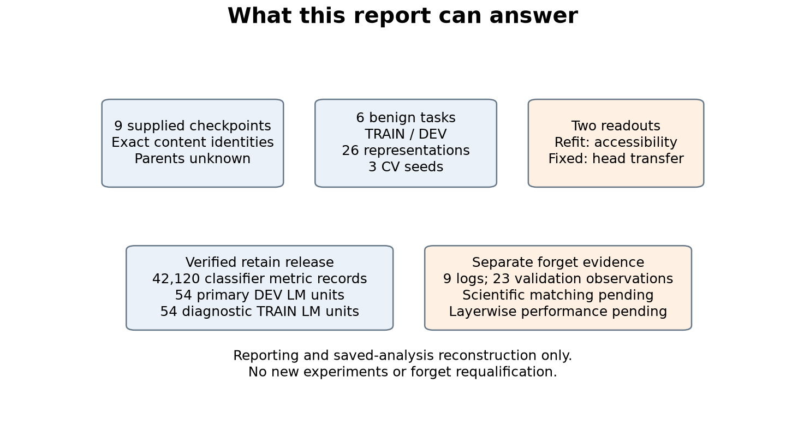
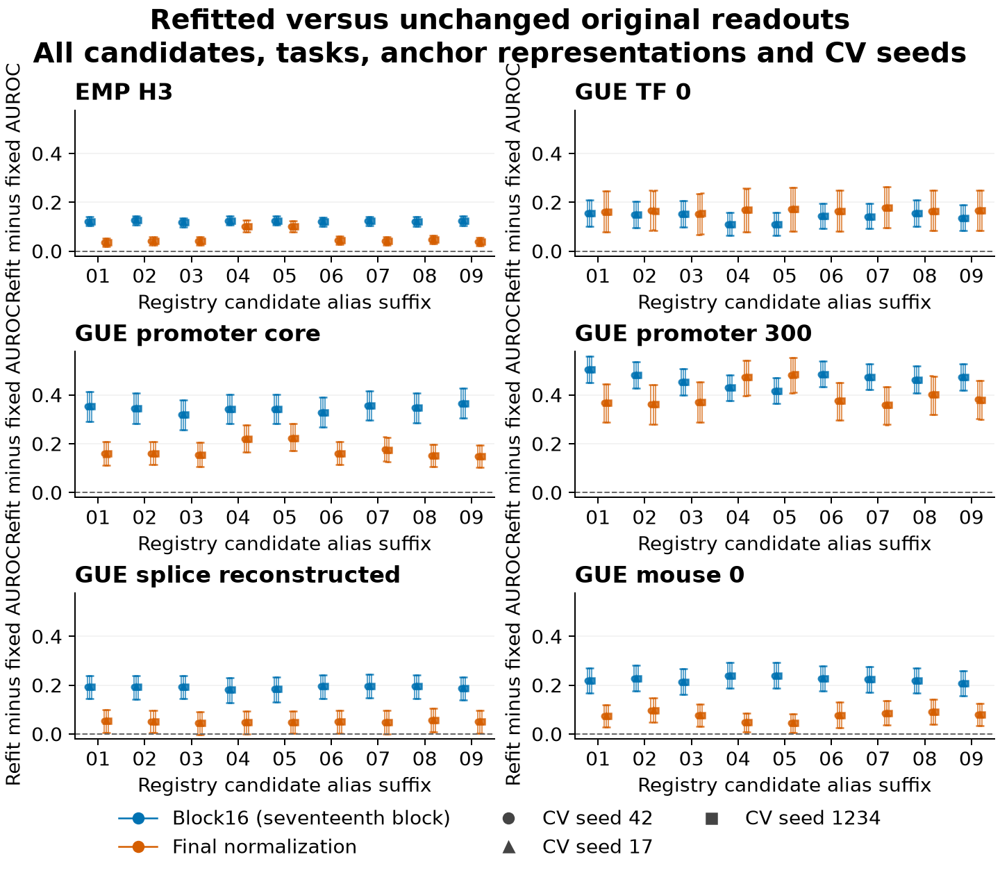
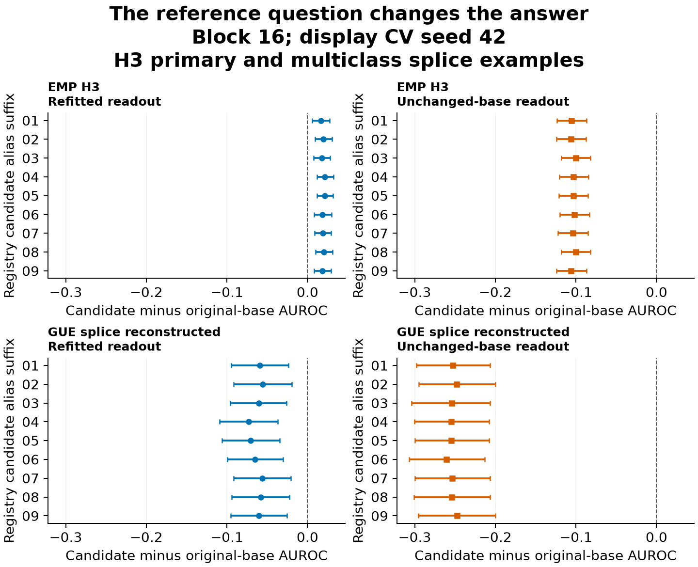

# Reviewer briefing

Verified retain results with recovered, scientifically unqualified forget-related source logs

## What we measured, and what can be concluded

We report 42,120 released classifier metric records across nine supplied checkpoints, six benign tasks, all 26 representations, three probe CV partitions and two distinct readout policies. Refitted probes and unchanged original-base probes answer different questions. At both emphasized representations, refitted AUROC exceeds the unchanged readout in 324 of 324 candidate/task/anchor/seed comparisons, with point gaps 0.034778 to 0.503517; 3 existing pointwise intervals include zero. Refitted block 16 AUROC exceeds final normalization descriptively in 162 of 162 candidate/task/seed combinations. Relative to the original pretrained base, results remain task-, layer-, metric- and policy-dependent, including adverse and inconclusive findings. Recovered forget logs contain 23 step-axis validation-loss observations, but no currently qualified scientific aggregate, checkpoint-matched comparison or layerwise forget-performance result. This report completes a bounded reporting scope; the original retain-and-forget request remains partial.

The original retain-and-forget request remains PARTIAL. The nine endpoints are supplied checkpoints with unresolved immediate parents, masks, realized dose and exposure. Nothing here establishes successful forgetting.

## Two readout questions give different answers

Refitted probes test accessibility under the frozen linear-classifier procedure. Fixed-base probes test compatibility with the exact unchanged original scaler/head. All 324 anchor AUROC point gaps favor refitting; 3 conditional intervals include zero. The 324 records are9 candidates ×6 tasks ×2 anchors ×3 CV seeds, not 324 independent interventions.

Block 16 is the seventeenth decoder block. Its refitted AUROC exceeds final normalization descriptively in 162/162 candidate/task/seed combinations. No new layer-to-layer interval or optimal-layer claim is introduced. All 26 representations remain in the full atlas.

## Adverse and inconclusive findings matter

Original-base comparisons answer a different question. For candidate 01, block 16, seed 42 and DEV AUROC, H3 refit minus base is 0.016405 [0.005905, 0.027233]; splice refit minus base is -0.058885 [-0.094801, -0.023727]. Original base is not a proven immediate parent.

Ranking and probability quality can disagree: 220/8,424 cells have higher AUROC but worse classifier cross-entropy than base. This is descriptive, not joint significance or a capability percentage. LM has 54 primary DEV and 54 diagnostic TRAIN units, not 108 independent held-out evaluations.

## Forget evidence, limitations and the next useful inputs

Forget-related source logs recovered; qualified integration pending. The 23 step-axis validation-loss observations and corresponding ppl values remain distinct from 92 loss/ppl/both-axis display records. Reinit5 A has two step 1500 values: 1.3953843116760254 and 1.3952388763427734. Both remain unresolved and preserved. Noise5 steps 2000/2151 are separate endpoints, not independent seeds.

The configurations declare702 versus 1 evaluation iterations. This is not a verified denominator. Exact checkpoint/invocation, metric/cohort/split, aggregation and implementation semantics remain unqualified. Layer-indexed gradient norms are diagnostics, not layerwise forget performance. No model-level loss is copied across layers.

Still needed: content-hash-bound validation/save receipts; producing evaluation source and cohort/aggregation metadata; compatible reference/uncertainty aggregates when available; genuine qualified layerwise forget-task aggregates. These belong in a separately versioned S10 assessment. Reuse all unaffected retain work; do not rerun the pipeline by default.

Conditional 95% pointwise intervals describe fixed heads and cohorts, not intervention replication or familywise confidence. Unknown parent/mask/dose/exposure, partial delivery inventory and historical candidate 05 privacy remain explicit limits. Current private protection cannot establish past visibility.

Evidence route: RESULTS.pdf and RESULTS.md; FIGURE_GALLERY.md for the complete111-figure retain atlas and source-log appendix; TABLE_INDEX.json and CLAIM_LEDGER.jsonl for exact rows; FRESH_CPU_RESTORE_CHECK.json for actual saved-analysis recovery residuals and locations; FINAL_RECEIPT.json for immutable delivery identities. No raw forget evaluation or collaborator messages were performed.

| Question | Observation | Limit |
|---|---|---|
| Readouts | 324 positive anchor gaps;3 intervals include zero | No intervention replication |
| Representations | 162/162 block16 points exceed finalnorm | Descriptive, no new layer inference |
| Forget evidence | 23 source validation-loss observations;0 qualified comparisons | Exact model/protocol/layerwise performance pending |
