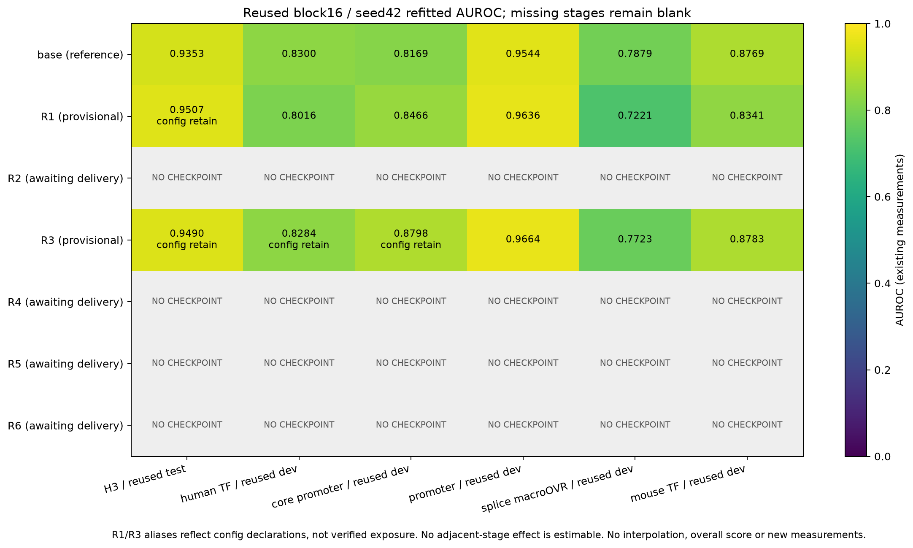
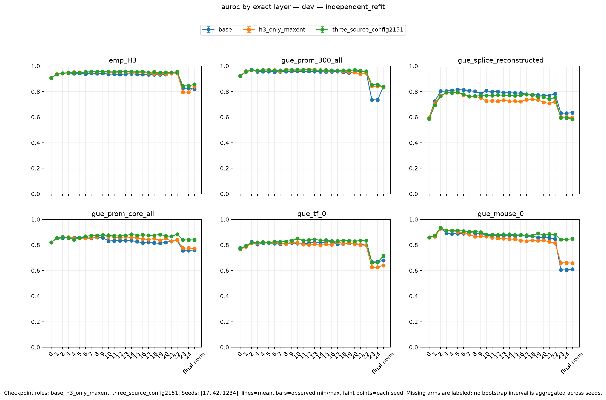
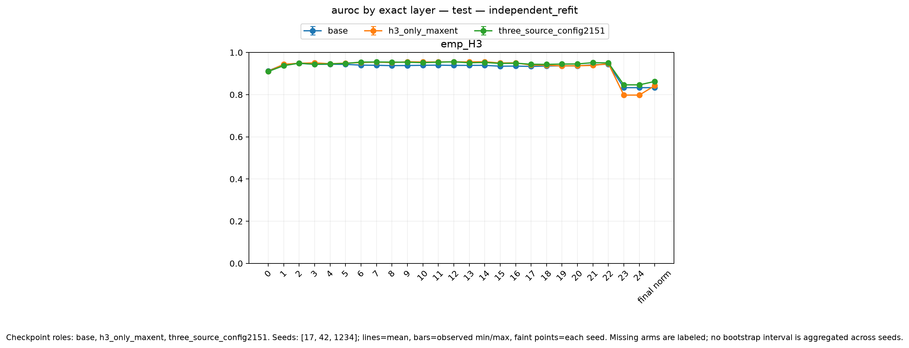
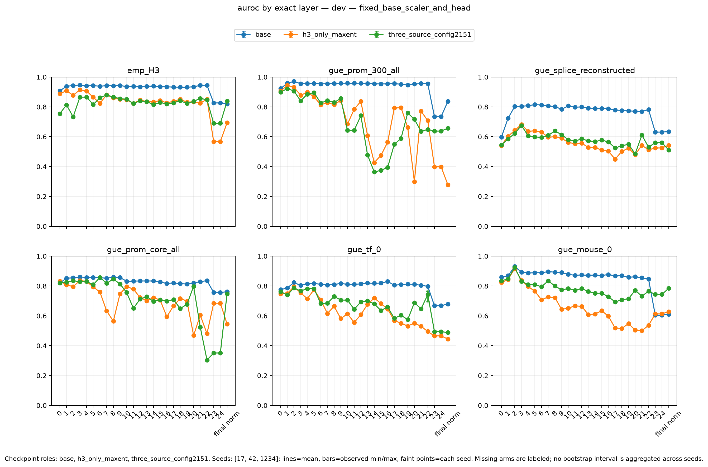

# Incremental retain evaluation: qualified continuation and delivery status

**No new model measurements were possible in this continuation.** The live supplied locations still contain the completed H3-only and three-source-config checkpoints; no identifiable R2/R4/R5/R6 or offered perturbation delivery was found. The registry/protocol/reporting handoff is complete; the expanded model matrix remains pending delivery. No models were generated and no completed arm was rerun. GPU use and new fits are both **zero**.

## Evidence reused and stage identities

The validated implementation is pinned to c79ab07e763a9754c68fdaf7d0730d8458f508dc. Existing base, H3-only and three-source results were verified again against990sealed receipts/15678files, including exact cohorts, heads/predictions/bootstrap/LM records and36controls. The original independent numerical audits are reused, not counted as new measurements or GPU replication. Source SHA/frozen runtime/hook/pooling/batching identities match.

R1 is the provisional alias for original `h3_only_maxent`, iteration2000, config declares H3. R3 provisionally aliases `supplied_three_source_config_iter2151`, config declares H3/humanTF0/core-promoter. Its shard SHA256 is a401c810f6479c090de26550b785e22a50280d15f4ef920f1f237b4a41df3ac0. Original identifiers and all per-arm tokenizer/checkpoint identities remain in CHECKPOINT_REGISTRY.json. These are provisional task-family mappings; exact retain-source versions/manifests and equality to benchmark-source identities remain unverified. These aliases establish neither realized exposure nor sequential fine-tuning. The R3 pointer still reads2151 and freshly retrieved R1/R3 configs match recorded SHA256 values. No large remote weights were downloaded or freshly hashed; live IDs/sizes/timestamps alone are not weight-identity proof.

| Stage | Agreed cumulative retain set | Delivery/result status | Completed task/layer/seed units reused |
|---|---|---|---:|
| base | Separate pretrained reference | complete |468|
| R1 | H3 | provisional alias, complete |468|
| R2 | R1 + human TF | awaiting checkpoint |0|
| R3 | R2 + core promoter | provisional config alias, complete |468|
| R4 | R3 + promoter | awaiting checkpoint |0|
| R5 | R4 + splice | awaiting checkpoint |0|
| R6 | R5 + mouse TF | awaiting checkpoint |0|

This is the November10 cumulative sequence, not the older promoter/splice-first proposal. Expected remaining incremental units:1872 (four missing checkpoints×468), not a completed measurement count. Sayyed’s two-day delivery expectation is context, not proof of arrival. No combination search or stage×perturbation grid is authorized or constructed.

## Stage-by-task anchors and declared membership

All values below are **reused**. Block16 is zero-based decoder.layers.16, the17th block; seed42 is the historical display anchor, not a favorable selected seed. R2/R4/R5/R6 values are absent in the machine tables rather than interpolated. R3−R1 is explicitly **nonadjacent**: both humanTF and core-promoter are planned additions across that gap. It cannot identify either task’s individual effect. H3 uses reused test; the other tasks use reused official dev. AUROC positive is numerical class1; splice is sorted-class macroOVR. Conditional95% intervals use2000paired exact/RC-group draws, pointwise and unadjusted.

| Task/split | Base | R1 | R3 | R3 − R1 [95% CI] | R3 − base [95% CI] | R3 config declaration |
|---|---:|---:|---:|---:|---:|---|
| emp_H3/test | 0.935324 | 0.950738 | 0.948960 | -0.001778 [-0.007604, +0.003956] | +0.013636 [+0.003627, +0.023514] | included |
| gue_tf_0/dev | 0.829975 | 0.801619 | 0.828432 | +0.026812 [-0.006171, +0.060078] | -0.001543 [-0.031863, +0.029524] | included |
| gue_prom_core_all/dev | 0.816868 | 0.846564 | 0.879799 | +0.033236 [+0.005188, +0.062930] | +0.062931 [+0.030901, +0.098080] | included |
| gue_prom_300_all/dev | 0.954391 | 0.963638 | 0.966430 | +0.002792 [-0.008700, +0.014209] | +0.012039 [-0.002300, +0.026993] | not listed; exposure unknown |
| gue_splice_reconstructed/dev | 0.787862 | 0.722105 | 0.772349 | +0.050243 [+0.018868, +0.082140] | -0.015513 [-0.048207, +0.020142] | not listed; exposure unknown |
| gue_mouse_0/dev | 0.876947 | 0.834092 | 0.878260 | +0.044168 [+0.015725, +0.073613] | +0.001313 [-0.027421, +0.029687] | not listed; exposure unknown |

The gray rows have no delivered checkpoint or score. “Config retain” means a source appears in the checkpoint configuration, not known row exposure. Every task/stage has separate planned role, actual config declaration and unknown-exposure columns in [STAGE_ANCHORS.csv](tables/STAGE_ANCHORS.csv). For missing artifacts, actual declarations remain unresolved even though the meeting plan is known. Fixed-base entries for base alias the same saved base predictions, with no duplicate fit.

## Adjacent-stage comparisons

| Required contrast | Missing endpoint(s) | Result |
|---|---|---|
| R2−R1 | R2 | pending |
| R3−R2 | R2 | pending |
| R4−R3 | R4 | pending |
| R5−R4 | R4,R5 | pending |
| R6−R5 | R5,R6 | pending |

No adjacent-stage difference is currently estimable. The exact historical R1−base, R3−base and nonadjacent R3−R1 differences remain in [REUSED_CONTRASTS.csv](tables/REUSED_CONTRASTS.csv), with source file/row and original contrast/policy names. No interval endpoints are averaged.

## Scientific questions answerable now

- **Newly included tasks:** relative to R1, R3 config adds both humanTF and core promoter. At block16, core-promoter refit AUROC increases +0.033236 [+0.005188,+0.062930]; humanTF +0.026812 [−0.006171,+0.060078] is uncertain. Neither is an adjacent single-task effect.
- **Previously retained H3:** block16 R3−R1 is −0.001778 [−0.007604,+0.003956]; final norm +0.019844 [+0.008910,+0.031323]. This does not prove preservation/equivalence without an agreed margin.
- **Tasks not in R3’s declaration:** splice improves +0.050243 [+0.018868,+0.082140] and mouseTF +0.044168 [+0.015725,+0.073613] at block16 versus R1. Splice still has a negative point gap to base (−0.015513 [−0.048207,+0.020142]); mouseTF’s point reaches base (+0.001313 [−0.027421,+0.029687]), without establishing equivalence. Promoter +0.002792 [−0.008700,+0.014209] versus R1 remains uncertain. Not in the declared mixture does not mean unseen.
- **Layer distribution:** existing R3−R1 seed42 refit signs are positive at24/26core-promoter,25/26humanTF,19/26splice,23/26mouseTF,17/26promoter and14/26H3-test representations. These correlated descriptive counts are not family-wide significance claims. Splice final-norm R3−R1 is −0.009713 [−0.052729,+0.035328], preserving an unfavorable/inconclusive outcome rather than selecting a peak layer.

Three original model identifiers, six reused dev cohorts, all26representations. Lines=mean across CVseeds17/42/1234; bars=observed seed minimum/maximum, faint points=seeds. These are seed variation, not confidence intervals or intervention-training replications. R1/R3 aliases are provisional. H3 test remains separate below.

Reused H3 test only, no pooling with other-task dev. All seed-specific values and all five metrics remain in [REUSED_METRICS.csv](tables/REUSED_METRICS.csv).

## Fixed-base transfer and final normalization

A fixed-base probe applies the original base scaler/head unchanged. Better refitting does not imply transferable coordinates or recovered biological understanding. Block16 fixed-base values and conditional contrasts:

| Task/split | Base | R1 | R3 | R3 − R1 [95% CI] | R3 − base [95% CI] | R3 config declaration |
|---|---:|---:|---:|---:|---:|---|
| emp_H3/test | 0.935324 | 0.847818 | 0.840817 | -0.007001 [-0.013360, -0.000752] | -0.094507 [-0.113624, -0.076370] | included |
| gue_tf_0/dev | 0.829975 | 0.644794 | 0.659308 | +0.014514 [-0.035283, +0.066075] | -0.170667 [-0.218291, -0.123553] | included |
| gue_prom_core_all/dev | 0.816868 | 0.593817 | 0.698270 | +0.104453 [+0.050339, +0.156231] | -0.118599 [-0.166553, -0.066592] | included |
| gue_prom_300_all/dev | 0.954391 | 0.562921 | 0.394308 | -0.168612 [-0.232867, -0.109993] | -0.560082 [-0.612261, -0.509719] | not listed; exposure unknown |
| gue_splice_reconstructed/dev | 0.787862 | 0.503159 | 0.565251 | +0.062091 [+0.025503, +0.103080] | -0.222611 [-0.264228, -0.179736] | not listed; exposure unknown |
| gue_mouse_0/dev | 0.876947 | 0.597069 | 0.727710 | +0.130641 [+0.090653, +0.172424] | -0.149237 [-0.191749, -0.107806] | not listed; exposure unknown |

The new/refitted versus transferred discrepancy remains substantial on several tasks, including promoter, splice and humanTF. Readout degradation does not prove information removal. Final-normalization refits are also retained rather than replaced by a selected best layer:

| Task/split | Base | R1 | R3 | R3 − R1 [95% CI] | R3 − base [95% CI] | R3 config declaration |
|---|---:|---:|---:|---:|---:|---|
| emp_H3/test | 0.833097 | 0.842691 | 0.862535 | +0.019844 [+0.008910, +0.031323] | +0.029439 [+0.014374, +0.046601] | included |
| gue_tf_0/dev | 0.679673 | 0.641601 | 0.714246 | +0.072645 [+0.015145, +0.130728] | +0.034573 [-0.019029, +0.090457] | included |
| gue_prom_core_all/dev | 0.761384 | 0.773286 | 0.837011 | +0.063725 [+0.031698, +0.095819] | +0.075627 [+0.035948, +0.117341] | included |
| gue_prom_300_all/dev | 0.836912 | 0.833890 | 0.836332 | +0.002441 [-0.036227, +0.042105] | -0.000580 [-0.040356, +0.041734] | not listed; exposure unknown |
| gue_splice_reconstructed/dev | 0.633834 | 0.592868 | 0.583155 | -0.009713 [-0.052729, +0.035328] | -0.050679 [-0.096799, -0.002135] | not listed; exposure unknown |
| gue_mouse_0/dev | 0.610656 | 0.658534 | 0.848153 | +0.189618 [+0.136037, +0.241254] | +0.237496 [+0.183113, +0.292489] | not listed; exposure unknown |

Same all-layer/three-seed summary; bars remain seed ranges, not confidence intervals. No new classifiers or control heads were fitted.

## Controls and within-task LM loss

Matched composition and normalized-forward4mer controls are reused once per task/seed at block16 and final norm. [control_contrasts.csv](tables/control_contrasts.csv) contains the R3 comparisons; [BASE_R1_CONTROL_CONTRASTS.csv](tables/BASE_R1_CONTROL_CONTRASTS.csv) preserves prior base/R1 comparisons. R3 block16 refits exceed the4mer control at all six seed42 task anchors under the original pointwise conditional intervals. These are comparisons with those particular controls, not proof of biological understanding or capacity-matched model superiority.

LM loss is one actual output-head statistic: total next-token loss divided by valid targets, then PPL=exp(NLL). It is not classifier cross-entropy or per-hidden-layer perplexity. Exact three-arm within-task values/intervals are reused in [LM_METRICS.csv](tables/LM_METRICS.csv) and [LM_CONTRASTS.csv](tables/LM_CONTRASTS.csv). On H3/test, base/R1/R3 causal NLL are1.310650139/1.455799276/1.221998229; R3−R1 is−0.233801 [−0.252156,−0.215530]. Thus LM loss improves while H3 block16 refit AUROC has a small negative, uncertain change. All five other tasks have favorable R3−R1 block16 AUROC and NLL point directions; this is a within-task observation, not an overall-capability score. Final-norm classification can differ while LM loss remains one output-head readout.

## Perturbation versus parent

No identifiable supplied perturbation checkpoint was found in the refreshed roots/relevant model folders or scoped accessible-folder name search. The two offers are placeholder registry entries awaiting delivery, not assigned Gaussian/reinitialization labels. Meeting discussion of5percent is not a verified selected fraction. No immediate parent, stage, intervention seed/settings or pre/post training is established. Therefore no perturbation-versus-parent measurements or causal claims exist. Historical GradDiff originals/v2 and LoRA checkpoint directories are explicitly excluded as substitutes. Unrelated hazardous benchmark contents were not read or executed.

## Qualification limits and next owners

R1/R3 parent/conversion hashes, executed objective/loader revision, actual sampling proportions, unique/repeated rows, per-source retain tokens and authorized-cohort exposure remain incomplete. Training steps and LR schedules differ (delivered R12000 versus R32151; planned decay schedules differ). A path containing base and a MaxEnt log tag do not resolve exact lineage/objective. Missing manifests mean exposure unknown, not clean. Exact/RC groups do not establish homology or biological independence. CVseeds are not independent intervention replications. No preservation margins or multiplicity correction were invented. Benign measurements alone do not establish successful unlearning.

**Sayyed next:** supply R2/R4/R5/R6 checkpoint folders with intended iteration, complete shard inventory and config/tokenizer; supply both offered perturbations with actual intervention type, parent hash/stage, fraction, seed/settings and any pre/post training. Also provide parent/conversion hashes, executed objective/loader revision, source/retain manifests and per-source sampling/token/exposure accounting. Do not ask Ashay to create these interventions.

**Ashay next:** qualify each identified delivery, freeze its identity and pass strict native loading plus unchanged training-only physical8 gates. Evaluate available incremental stages in agreed order (missing earlier stage need not block a later descriptive arm), completing H3/audit before other five; then qualified perturbations against actual available parent. Reuse verified caches/controls, fit only new heads, independently verify new outputs and recover them privately. No indefinite polling is running.

## Verification, delivery and recovery

[COMPARISON_PROTOCOL.json](COMPARISON_PROTOCOL.json), [CHECKPOINT_REGISTRY.json](CHECKPOINT_REGISTRY.json) and [COVERAGE.json](COVERAGE.json) preserve all states and identities. New checks are deterministic stage/membership/adjacency tests and source-table/annotation/figure consistency; they are not new scientific measurements. Full prior numerical audits remain the basis for reused scores. New GPU-stage use0seconds, new fits0, new predictions0. Resource receipts distinguish this continuation from historical375.8GPU-stage seconds for R3.

New outputs form a small dependent supplement. Restore prior base/R1, controls and R3 archives at their pinned private revisions before the new preparation bundle; [RESTORE_DEPENDENCIES.json](RESTORE_DEPENDENCIES.json) records hashes and order. Model weights and installed runtime are excluded. [Private backup and restored-artifact verification passed](BACKUP.md); final backup/restore receipts postdate packaging and are preserved in Git. No collaborator messages, main merge, force push, intervention training or Pod shutdown occurred.
