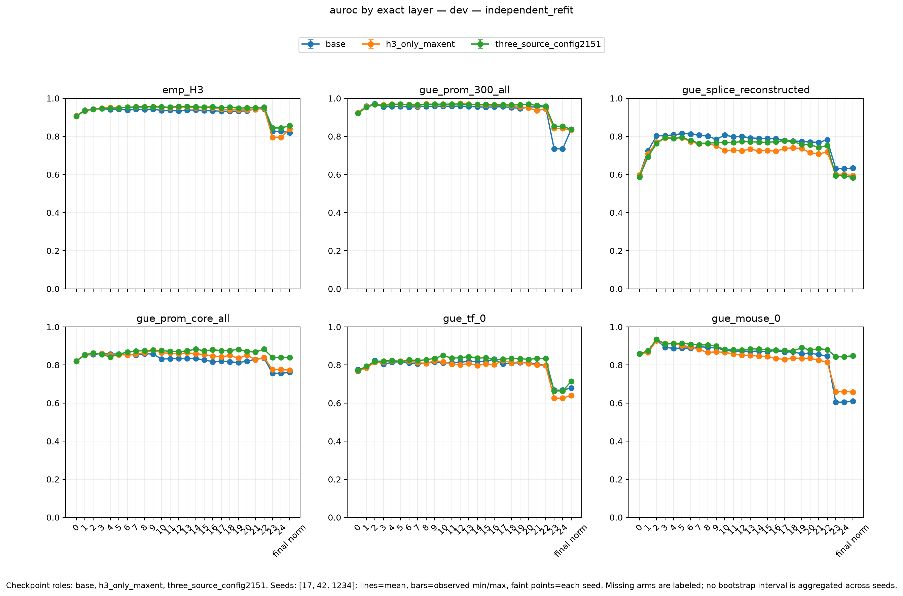
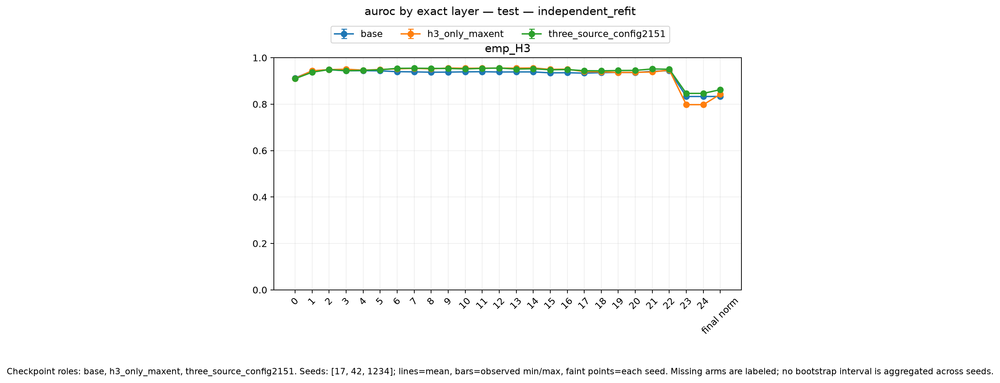
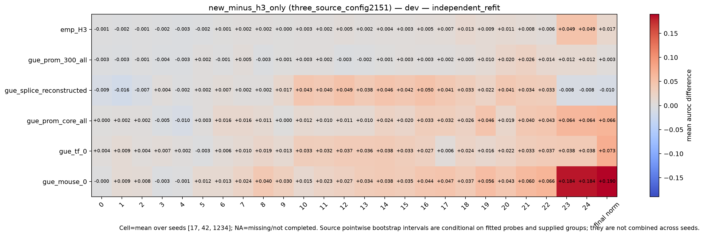
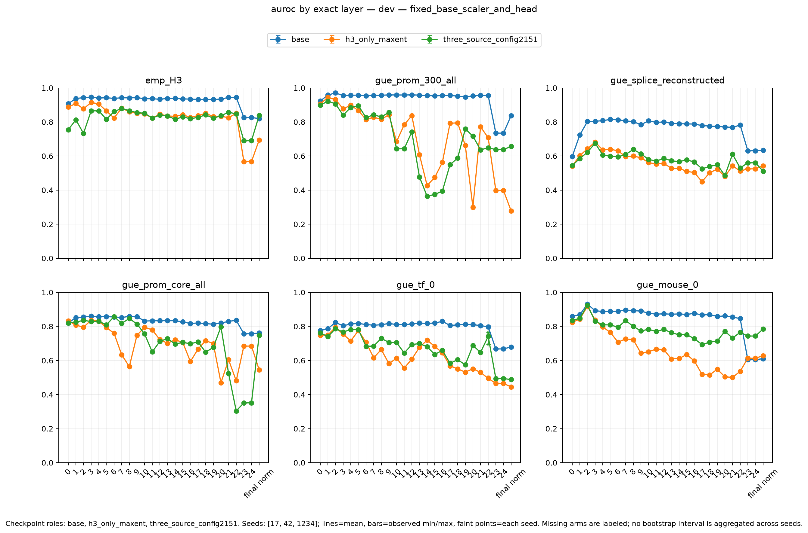

# Supplied three-source-config checkpoint: descriptive benign comparison

The supplied checkpoint is **iteration2151**, identified by its explicit latest pointer, matching latest/per-iteration state, planned train_iters2151 and same-job progress. Exact selected shard SHA256a401c810f6479c090de26550b785e22a50280d15f4ef920f1f237b4a41df3ac0;234/254 model tensors differ from the H3-only reference. It is not a renamed duplicate. Its config declares **H3, humanTF0 and core promoter** retain sources. This establishes the three-source configuration, not realized proportions/row exposure. Supplemental training-log tags explicitly name MaxEnt loss, adding artifact-level reporting evidence. Exact objective execution/formula/revision remains unverified; neither folder name, dataset GradDiff provider nor tag names alone prove it. Label: supplied_three_source_config_iter2151.

The three-arm descriptive evaluation is complete on six exact qualified cohorts,26representations and CVseeds42/17/1234. Only468 new logistic heads were fitted; base/H3-only caches, heads, predictions and36matched controls were reused. No new backbone/intervention training, harmful benchmark evaluation or untouched test access. The comparison protocol was frozen before new heldout inference but after prior studies: this remains exploratory reuse. Retain-diversity causal attribution is unsupported, independently of descriptive evaluation validity.

## Six-task comparison at the declared anchors

Refitted heads; historical display seed42, not a selected favorable seed. Base/H3-only values are reused verified references. Binary AUROC uses numerical class1; splice macro-OVR. Each paired interval is2000 exact/RC-group bootstrap draws, pointwise/unadjusted and conditional on fitted heads. Block16 is zero-based, the17th block. H3/test is separate from other-task dev. All seeds, all26representations and all5metrics are in machine-readable tables; anchor contrasts for every seed are supplied separately.

| Task/split | Representation | Base | H3-only | New | New − H3-only [95% CI] | New − base [95% CI] |
|---|---|---:|---:|---:|---:|---:|
| emp_H3/test | block16 | 0.935324 | 0.950738 | 0.948960 | -0.001778 [-0.007604, +0.003956] | +0.013636 [+0.003627, +0.023514] |
| emp_H3/test | final norm | 0.833097 | 0.842691 | 0.862535 | +0.019844 [+0.008910, +0.031323] | +0.029439 [+0.014374, +0.046601] |
| gue_prom_300_all/dev | block16 | 0.954391 | 0.963638 | 0.966430 | +0.002792 [-0.008700, +0.014209] | +0.012039 [-0.002300, +0.026993] |
| gue_prom_300_all/dev | final norm | 0.836912 | 0.833890 | 0.836332 | +0.002441 [-0.036227, +0.042105] | -0.000580 [-0.040356, +0.041734] |
| gue_prom_core_all/dev | block16 | 0.816868 | 0.846564 | 0.879799 | +0.033236 [+0.005188, +0.062930] | +0.062931 [+0.030901, +0.098080] |
| gue_prom_core_all/dev | final norm | 0.761384 | 0.773286 | 0.837011 | +0.063725 [+0.031698, +0.095819] | +0.075627 [+0.035948, +0.117341] |
| gue_splice_reconstructed/dev | block16 | 0.787862 | 0.722105 | 0.772349 | +0.050243 [+0.018868, +0.082140] | -0.015513 [-0.048207, +0.020142] |
| gue_splice_reconstructed/dev | final norm | 0.633834 | 0.592868 | 0.583155 | -0.009713 [-0.052729, +0.035328] | -0.050679 [-0.096799, -0.002135] |
| gue_tf_0/dev | block16 | 0.829975 | 0.801619 | 0.828432 | +0.026812 [-0.006171, +0.060078] | -0.001543 [-0.031863, +0.029524] |
| gue_tf_0/dev | final norm | 0.679673 | 0.641601 | 0.714246 | +0.072645 [+0.015145, +0.130728] | +0.034573 [-0.019029, +0.090457] |
| gue_mouse_0/dev | block16 | 0.876947 | 0.834092 | 0.878260 | +0.044168 [+0.015725, +0.073613] | +0.001313 [-0.027421, +0.029687] |
| gue_mouse_0/dev | final norm | 0.610656 | 0.658534 | 0.848153 | +0.189618 [+0.136037, +0.241254] | +0.237496 [+0.183113, +0.292489] |

## Splice/mouse deficits, H3 and other tasks

A positive new-minus-H3 difference means the point estimate improves relative to H3-only. The new-minus-base column shows whether a deficit relative to base remains. Without agreed preservation margins, neither a near-zero point nor an interval spanning zero establishes preservation/equivalence. Values and uncertainty at block16:

- emp_H3/test, block16: new minus H3-only -0.001778 [-0.007604, +0.003956]; new minus base +0.013636 [+0.003627, +0.023514].
- gue_prom_300_all/dev, block16: new minus H3-only +0.002792 [-0.008700, +0.014209]; new minus base +0.012039 [-0.002300, +0.026993].
- gue_prom_core_all/dev, block16: new minus H3-only +0.033236 [+0.005188, +0.062930]; new minus base +0.062931 [+0.030901, +0.098080].
- gue_splice_reconstructed/dev, block16: new minus H3-only +0.050243 [+0.018868, +0.082140]; new minus base -0.015513 [-0.048207, +0.020142].
- gue_tf_0/dev, block16: new minus H3-only +0.026812 [-0.006171, +0.060078]; new minus base -0.001543 [-0.031863, +0.029524].
- gue_mouse_0/dev, block16: new minus H3-only +0.044168 [+0.015725, +0.073613]; new minus base +0.001313 [-0.027421, +0.029687].

- gue_splice_reconstructed: block16/seed42 point deficit is smaller versus H3-only; a negative point gap to base remains. New-vs-H3 conditional interval: [+0.018868, +0.082140].
- gue_mouse_0: block16/seed42 point deficit is smaller versus H3-only; the new point estimate reaches/exceeds base, without establishing preservation/equivalence. New-vs-H3 conditional interval: [+0.015725, +0.073613].

## Layers and readout policies

The full profiles retain all26representations; no maximum heldout layer or favorable CVseed is selected. Descriptive sign counts quantify distribution across the stack, not a family-wide inferential claim:

- emp_H3/test: 14/26 representation point differences positive and 12/26 negative versus H3-only (seed42 refit). These correlated descriptive signs are not26 significance tests or a selected-layer performance claim.
- gue_prom_300_all/dev: 17/26 representation point differences positive and 9/26 negative versus H3-only (seed42 refit). These correlated descriptive signs are not26 significance tests or a selected-layer performance claim.
- gue_prom_core_all/dev: 24/26 representation point differences positive and 2/26 negative versus H3-only (seed42 refit). These correlated descriptive signs are not26 significance tests or a selected-layer performance claim.
- gue_splice_reconstructed/dev: 19/26 representation point differences positive and 7/26 negative versus H3-only (seed42 refit). These correlated descriptive signs are not26 significance tests or a selected-layer performance claim.
- gue_tf_0/dev: 25/26 representation point differences positive and 1/26 negative versus H3-only (seed42 refit). These correlated descriptive signs are not26 significance tests or a selected-layer performance claim.
- gue_mouse_0/dev: 23/26 representation point differences positive and 3/26 negative versus H3-only (seed42 refit). These correlated descriptive signs are not26 significance tests or a selected-layer performance claim.

All six reused dev cohorts, independently refitted probes. Splice macro-OVR AUROC, others binary AUROC. Lines=mean across seeds17/42/1234, bars=observed seed min/max, faint points=individual seeds. These ranges are not bootstrap confidence intervals. H3 test is shown separately below; source conditional intervals remain per-seed CSV values.

Reused exploratory H3 test only, same all-layer/refit/three-seed summary and seed-range interpretation. No pooling with other-task dev.

All reused dev cohorts and26representations; cells show seed-mean new-minus-H3-only AUROC differences. Red positive, blue negative; no averaged CI endpoints or adjusted significance. Exact all-seed differences and separate conditional intervals in CSV. New-minus-base heatmaps and standard PDF/SVG/PNG exports remain in the artifact report tree.

Fixed-base policy applies the original base scaler/head unchanged to each same-layer model representation. The base reference is an alias of base-refit predictions, not another fit. Differences in transfer and refitting can reflect readout/feature drift; they do not prove information absence or recovery under arbitrary classifiers.

| Task/split | Representation | Base | H3-only | New | New − H3-only [95% CI] | New − base [95% CI] |
|---|---|---:|---:|---:|---:|---:|
| emp_H3/test | block16 | 0.935324 | 0.847818 | 0.840817 | -0.007001 [-0.013360, -0.000752] | -0.094507 [-0.113624, -0.076370] |
| emp_H3/test | final norm | 0.833097 | 0.668706 | 0.835342 | +0.166636 [+0.142774, +0.189178] | +0.002246 [-0.012295, +0.017254] |
| gue_prom_300_all/dev | block16 | 0.954391 | 0.562921 | 0.394308 | -0.168612 [-0.232867, -0.109993] | -0.560082 [-0.612261, -0.509719] |
| gue_prom_300_all/dev | final norm | 0.836912 | 0.278614 | 0.656596 | +0.377981 [+0.320872, +0.440956] | -0.180316 [-0.235816, -0.122800] |
| gue_prom_core_all/dev | block16 | 0.816868 | 0.593817 | 0.698270 | +0.104453 [+0.050339, +0.156231] | -0.118599 [-0.166553, -0.066592] |
| gue_prom_core_all/dev | final norm | 0.761384 | 0.545718 | 0.748505 | +0.202786 [+0.149395, +0.260671] | -0.012879 [-0.051534, +0.025884] |
| gue_splice_reconstructed/dev | block16 | 0.787862 | 0.503159 | 0.565251 | +0.062091 [+0.025503, +0.103080] | -0.222611 [-0.264228, -0.179736] |
| gue_splice_reconstructed/dev | final norm | 0.633834 | 0.543252 | 0.511555 | -0.031697 [-0.074456, +0.011917] | -0.122279 [-0.173519, -0.069280] |
| gue_tf_0/dev | block16 | 0.829975 | 0.644794 | 0.659308 | +0.014514 [-0.035283, +0.066075] | -0.170667 [-0.218291, -0.123553] |
| gue_tf_0/dev | final norm | 0.679673 | 0.444580 | 0.487755 | +0.043175 [-0.032285, +0.112777] | -0.191918 [-0.255414, -0.132976] |
| gue_mouse_0/dev | block16 | 0.876947 | 0.597069 | 0.727710 | +0.130641 [+0.090653, +0.172424] | -0.149237 [-0.191749, -0.107806] |
| gue_mouse_0/dev | final norm | 0.610656 | 0.628260 | 0.784641 | +0.156382 [+0.103106, +0.209314] | +0.173985 [+0.118564, +0.227030] |

All six reused dev cohorts; frozen base scaler/head; same numerical AUROC definitions and three-seed mean/min/max summary, not conditional confidence intervals.

## Matched controls and actual causal LM loss

The same composition/normalized-forward-4mer heads from the independently verified matched-controls study are reused once per task/seed. No per-layer or per-model control fitting. New block16 refit minus controls at seed42:

- emp_H3/test, block16, new-refit minus composition: +0.143600 [+0.122027, +0.167382].
- emp_H3/test, block16, new-refit minus 4mer: +0.053509 [+0.039345, +0.068943].
- gue_prom_300_all/dev, block16, new-refit minus composition: +0.327001 [+0.274999, +0.375357].
- gue_prom_300_all/dev, block16, new-refit minus 4mer: +0.074327 [+0.049021, +0.100778].
- gue_prom_core_all/dev, block16, new-refit minus composition: +0.127121 [+0.084929, +0.168832].
- gue_prom_core_all/dev, block16, new-refit minus 4mer: +0.044528 [+0.014811, +0.075256].
- gue_splice_reconstructed/dev, block16, new-refit minus composition: +0.269447 [+0.213422, +0.324487].
- gue_splice_reconstructed/dev, block16, new-refit minus 4mer: +0.200636 [+0.149256, +0.253595].
- gue_tf_0/dev, block16, new-refit minus composition: +0.308342 [+0.250178, +0.365432].
- gue_tf_0/dev, block16, new-refit minus 4mer: +0.038836 [+0.002840, +0.073618].
- gue_mouse_0/dev, block16, new-refit minus composition: +0.351580 [+0.295186, +0.407405].
- gue_mouse_0/dev, block16, new-refit minus 4mer: +0.089802 [+0.046440, +0.130947].

Full anchor/control comparisons include final norm, fixed-base transfer, all seeds and all five metrics. Performance beyond these particular controls does not prove biological understanding; control/model dimensions and capacities differ. Historical original-backend controls are not substituted as matched effects.

LM loss is one actual output-head readout per sequence, not per-hidden-layer perplexity or classifier cross-entropy. Natural-log loss uses valid next-token targets, saved float32 sequence sums and float64 target-weighted aggregation; PPL=exp(corpus NLL). New-minus-H3 draws are also checked directly from both sets of saved sums/counts, not an unweighted mean of sequence PPLs. No cross-task PPL leaderboard is inferred.

| Task/split | Arm | Causal NLL | PPL | Valid targets |
|---|---|---:|---:|---:|
| H3/test | base | 1.310650139 | 3.708584024 | 747003 |
| H3/test | new_checkpoint | 1.221998229 | 3.393962878 | 747003 |
| H3/test | h3_only_maxent | 1.455799276 | 4.287909318 | 747003 |

- H3/test causal_nll, new_checkpoint_minus_base: -0.088652 [-0.095200, -0.082249].
- H3/test perplexity, new_checkpoint_minus_base: -0.314621 [-0.336281, -0.293191].
- H3/test causal_nll, h3_only_maxent_minus_base: +0.145149 [+0.125018, +0.164042].
- H3/test perplexity, h3_only_maxent_minus_base: +0.579325 [+0.494715, +0.660458].
- H3/test causal_nll, new_checkpoint_minus_h3_only: -0.233801 [-0.252156, -0.215530].
- H3/test perplexity, new_checkpoint_minus_h3_only: -0.893946 [-0.971040, -0.815426].

- emp_H3/test: block16 refit AUROC and causal NLL point directions disagree (higher AUROC/lower NLL favorable); NLL new−H3 -0.233801 [-0.252156, -0.215530].
- gue_prom_300_all/dev: block16 refit AUROC and causal NLL point directions agree (higher AUROC/lower NLL favorable); NLL new−H3 -0.094927 [-0.103480, -0.086010].
- gue_prom_core_all/dev: block16 refit AUROC and causal NLL point directions agree (higher AUROC/lower NLL favorable); NLL new−H3 -0.057399 [-0.066563, -0.048858].
- gue_splice_reconstructed/dev: block16 refit AUROC and causal NLL point directions agree (higher AUROC/lower NLL favorable); NLL new−H3 -0.092403 [-0.102350, -0.083159].
- gue_tf_0/dev: block16 refit AUROC and causal NLL point directions agree (higher AUROC/lower NLL favorable); NLL new−H3 -0.109177 [-0.126602, -0.092668].
- gue_mouse_0/dev: block16 refit AUROC and causal NLL point directions agree (higher AUROC/lower NLL favorable); NLL new−H3 -0.011340 [-0.018870, -0.003499].

All other task/split LM values and paired intervals are in LM_METRICS.csv/LM_CONTRASTS.csv. Classification and LM loss assess different quantities. The within-task directional bullets refer specifically to block16; final-normalization classification may tell a different story while LM loss remains one output-head statistic. Neither is a surrogate for the other.

## Verification, provenance and interpretation limits

Strict native loading, unchanged BF16/FP32/unfused-attention policy and54fixed8 repeat/logical-batch comparisons passed under original tolerances before heldout inference. Existing base/H3 caches passed478receipt/9156file checks, controls36units/204files. The sole new arm used the existing multi-hook masked nucleotide-pooling path once per cohort. Padding/fillers were excluded, no extra truncation or cohort changes. Source/runtime/tokenizer and per-unit identities are retained.

Grouped training folds match the original exact IDs for every task/seed. Fold-local StandardScaler, balanced L2 LBFGS, C=.1/1/10, smaller-C tie, tol1e-4,2000 then10000 convergence retry, all-training refit. New-arm CV uses four independent one-thread workers and one-thread final refit, with explicit managed worker lifecycle. Independent audits reconstruct every saved head/probability, verify source joins/C/folds/finite tensors and recompute all metrics/bootstrap draws with separate pairwise/threshold calculations. Paired new-vs-H3/control contrasts receive additional independent checks. This is saved-output computational verification, not independent GPU regeneration or intervention replication. Focused baseline-reuse and binary/multiclass paired-contrast tests are synthetic checks, not scientific measurements.

H311971train/1497dev/1497test and other-task1024train/512officialdev remain exact. No new test opening. Unknown biological/source-genome grouping, numeric biological labels and exact training aliases remain qualified as gaps; exact/RC groups do not establish homology independence. Three CVseeds vary training folds/C selection, not checkpoint training seeds. No multiple-comparison correction or preservation margin was prespecified.

The causal retain-diversity question remains unsupported: parent/conversion hashes, objective/loader execution revision, actual mixture weights/per-source row exposure and retain-token budgets are absent. New2151 versus old2000 steps already differ. Rounded0.28billion combined log tokens and logical sample counters are not exact retain-stream or unique-example exposure. A listed validation/test prefix does not establish training exposure; no exposed-row pruning or claim of clean heldout evaluation. See COMPARABILITY_AND_EXPOSURE.md and BLOCKER_RESOLUTION.md.

Execution commits are recorded per feature/fitting unit and differ from final documentation commits. Reports/figures map to exact numerical files and hashes. Full new data remain under the artifact root; old base/H3 and control artifacts are read-only references. The new recovery package explicitly depends on those two immutable verified private archives and excludes model weights/installed runtime. Backup/restore receipts are published after packaging; no collaborator message or Pod shutdown is performed.
