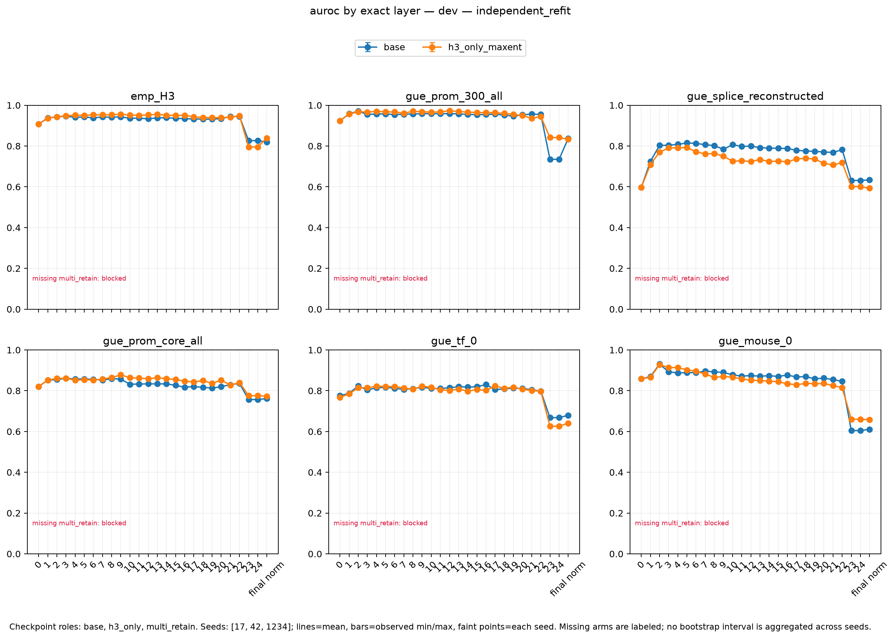
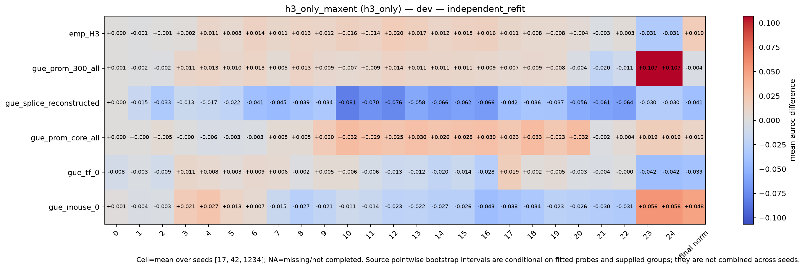
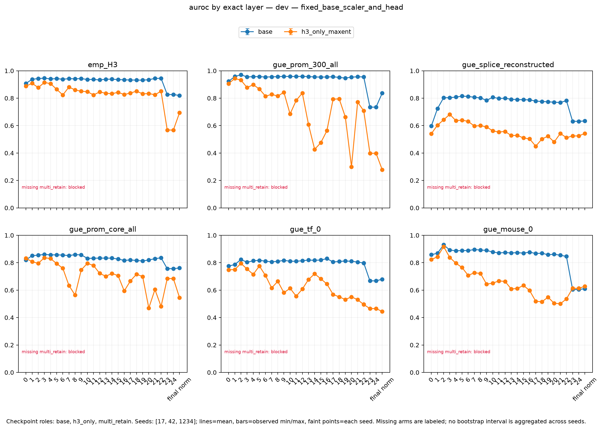

# All-layer benign base / H3-only checkpoint comparison

The available six-task comparison is complete: matched base and H3-only MaxEnt, 25 post-block outputs plus final normalization, and training-CV seeds 42, 17 and 1234. The broader multi-retain assignment is **deferred: no qualified multi-retain checkpoint was identified**. No supplied noise checkpoint was available. These results do not answer whether broader retain training reduces the splice or mouse-TF deficits.

There are 468 task/layer/seed units and 936 final logistic heads. Each unit includes independent refits and unchanged base-scaler/base-head transfer to H3-only features. All 8,190 probe scalar records, 5,460 paired probe contrasts, 28 LM scalar records and 14 LM contrasts passed separate CPU calculation paths. They are correlated records, not thousands of independent experiments. New GPU feature extraction was not independently replicated by the CPU audit.

## Predeclared representation anchors

The table uses the historical anchor seed 42 and exact implementation modules `decoder.layers.16` (zero-based, the 17th block) and `decoder.final_norm`. No favorable seed or held-out layer was selected. AUROC is binary class-1 discrimination except splice, which is macro one-vs-rest. Differences are H3-only minus base. Each interval uses 2,000 paired exact/reverse-complement group bootstrap draws, conditional on the fitted heads, pointwise and unadjusted. All source values and all seeds are in [native_metrics.csv](tables/native_metrics.csv) and [native_contrasts.csv](tables/native_contrasts.csv).

| Task/split | Representation | Base refit | H3-only refit | H3-only fixed-base | Refit difference [95% CI] |
|---|---|---:|---:|---:|---:|
| H3/test | block 16 | 0.935324 | 0.950738 | 0.847818 | +0.015414 [+0.005073, +0.025747] |
| H3/test | final norm | 0.833097 | 0.842691 | 0.668706 | +0.009595 [-0.007311, +0.026742] |
| Promoter/dev | block 16 | 0.954391 | 0.963638 | 0.562921 | +0.009247 [-0.003233, +0.022708] |
| Promoter/dev | final norm | 0.836912 | 0.833890 | 0.278614 | -0.003021 [-0.043876, +0.038179] |
| Splice (macro OVR)/dev | block 16 | 0.787862 | 0.722105 | 0.503159 | -0.065757 [-0.100514, -0.032184] |
| Splice (macro OVR)/dev | final norm | 0.633834 | 0.592868 | 0.543252 | -0.040965 [-0.088370, +0.006252] |
| Core promoter/dev | block 16 | 0.816868 | 0.846564 | 0.593817 | +0.029695 [-0.004860, +0.063562] |
| Core promoter/dev | final norm | 0.761384 | 0.773286 | 0.545718 | +0.011903 [-0.031836, +0.054586] |
| Human TF/dev | block 16 | 0.829975 | 0.801619 | 0.644794 | -0.028355 [-0.061276, +0.005762] |
| Human TF/dev | final norm | 0.679673 | 0.641601 | 0.444580 | -0.038072 [-0.102639, +0.025286] |
| Mouse TF/dev | block 16 | 0.876947 | 0.834092 | 0.597069 | -0.042855 [-0.076295, -0.012301] |
| Mouse TF/dev | final norm | 0.610656 | 0.658534 | 0.628260 | +0.047878 [-0.018430, +0.112736] |

At block 16, H3 refitted classification increases, while splice and mouse TF decrease. Splice's current difference is about -0.06576 and mouse TF's -0.04285; their intervals exclude zero under this limited dependence model. This repeats the direction of the earlier two-representation comparison. No broader-retain model was measured, so a reduction of those deficits remains unknown. Human TF also has a negative point difference. Other intervals spanning zero express uncertainty; they do not certify preservation.

## Full profiles and seed variation

All six reused development splits; separately selected/refitted heads; all 26 representations and seeds 17/42/1234. Lines show seed means, bars observed seed minimum/maximum, faint points individual seeds. These are **not bootstrap confidence intervals**. Splice is macro-OVR AUROC; the other tasks are binary AUROC. Multi-retain is explicitly missing. H3 test remains separate in the anchor table and full artifact figure exports.

The available checkpoint differences vary by layer and task. Splice refits are lower through much of the intermediate stack; the gap is not limited to final normalization. H3-only mouse-TF performance is lower across many middle/later blocks but higher at final normalization. Promoter and H3 retain substantial linear decodability at many earlier tested blocks even where final outputs are weaker. At block 0, the H3-only H3-test AUROC is 0.910580 and promoter-dev AUROC 0.923583 for every CV seed; these descriptive fixed-layer values are not claims about an optimally selected layer. The full profiles, rather than an evaluated maximum, are the evidence.

H3-only minus base, independent-refit policy, all reused dev splits, all 26 representations; each cell is the mean of the three seed point differences. Red is positive and blue negative. Displayed cell values are rounded to three decimals; exact per-seed values and their separate conditional intervals remain in CSV. No interval endpoints are combined across seeds and no multiple-comparison correction was prespecified.

Seeds change stratified grouped training folds and hence C selection. They do not create new pretrained models or interventions. For the 12 block-16/final-norm task anchors, 10 have identical AUROCs across all seeds and policies. The H3-only final-norm promoter AUROC ranges 0.832242–0.833890 and human TF 0.640486–0.641601. Identical selected C with a deterministic full-training refit often yields identical heads; this is limited selection variability, not independent replication. All seed outcomes remain visible.

## Fixed-base transfer and LM loss

All reused dev splits, frozen base scaler/head applied unchanged to the same-layer H3-only features, all three CV seeds and 26 representations. The base line is the same base-refit reference, not an additional fit. Lines/bars are seed means/ranges, not conditional confidence intervals. Splice uses macro-OVR AUROC.

At H3 test block 16, H3-only scores 0.950738 after refitting versus 0.847818 with the fixed base probe; at final norm, 0.842691 versus 0.668706. Promoter final-norm fixed-base AUROC is 0.278614 despite a refitted value around 0.833. This is compatible with substantial feature/readout drift. It does not prove information is absent, retained under every classifier, or recoverable under arbitrary downstream methods. Accuracy, balanced accuracy, binary/macro-OVR AP and classifier cross-entropy are retained alongside AUROC; majority-class accuracy alone is not a discrimination result.

H3-test causal NLL worsens from **1.310650139 to 1.455799276** and PPL from **3.708584024 to 4.287909318** while refitted block-16 classification improves. The paired NLL increase is 0.145149137 [0.125018175, 0.164042370]; PPL increase 0.579325294 [0.494715372, 0.660458193]. LM loss uses natural logs, one actual LM output head, next-token targets and float64 aggregation of saved float32 sequence loss sums/counts: total loss / total targets, then exponentiation. H3 test has 747,003 targets per arm. It is neither classifier cross-entropy nor per-hidden-layer perplexity. [LM tables](tables/LM_METRICS.csv) and [paired LM intervals](tables/LM_CONTRASTS.csv) cover every task/split separately; no cross-task PPL leaderboard is inferred.

## Protocol, provenance and audit

H3 uses the qualified 11,971/1,497/1,497 train/dev/test manifest; each other task uses 1,024 train and 512 official-dev examples. H3 dev/test and the other dev sets are exploratory reused populations. No untouched other-task test member was opened. Exact/RC cross-split overlaps and label conflicts were absent; one within-split splice duplicate group was preserved. Biological/source-genome homology groups and some label/TF aliases remain unqualified.

Both checkpoints are exact hash-matched native Evo2/BioNeMo artifacts: base iteration 1 (128 shards), H3-only MaxEnt iteration 2000. The collaborator statement confirming the supplied base parent is preserved separately from absent upstream conversion, exposure and training-token proof. MaxEnt and inspected GradDiff configurations explicitly name H3-only retention. No candidate was relabeled as multi-retain. The qualified registry is `CHECKPOINT_REGISTRY_QUALIFIED.json`, not the older incomplete registry.

Protocol SHA256 `ee8bcd6d2c6e9c0f60a457f4ed10eff44dbcb23c80167ee2009e752857a355a6`. Base/H3 manifests, checkpoint hashes, runtime lock, tokenizer identities and layer registry are recorded in the run. All layers use masked nucleotide-mean pooling, length 1,000 right-padding without sequence truncation and no inserted BOS/EOS. Physical batches always contain eight rows; filler rows are excluded from every saved output. The original variable-batch route failed unchanged tolerance because native BF16 arithmetic depended on physical shape; those failures remain preserved. Fixed-8 repeats/logical-batch/history checks passed 116 comparisons before new held-out extraction. No dtype/weight/tolerance change was used to mask a failure. Native BF16/FP32 and unfused attention were retained; only documented lossless filter promotions and qualified TE extra state are allowed. There is no general original-backend/BioNeMo equivalence claim.

Training-only CV uses identical stratified exact/RC-group folds across arms (H3 three, other tasks five); fold-local StandardScaler; balanced L2 logistic regression; C=.1,1,10; smaller-C ties; LBFGS tol=1e-4, initial 2,000 iterations and a 10,000-iteration retry only for convergence warnings. Final fits use every qualified training row. Binary threshold is .5; splice uses sorted numeric classes and argmax. There are 13,104 CV fits with 44 extra attempts and 936 final heads with six extra attempts. All 50 initial warning events are preserved; every final attempt converged. Selected-C counts are .1:814, 1:21, 10:101. No probe metric resample was invalid. Numerical worker cleanup KeyErrors were retained; eight serial CV diagnostic recomputations matched scores exactly. The complete probability/metric audit, not cleanup diagnosis alone, is the correctness gate.

Extraction execution: H3 `4f9aa65518f58b44a2afc76cec6f96c240115916`; other tasks `2e50da5895b5488d8d9378722ad20ea6bd63e264` with the same computational extractor. Fixed-batch smoke source `902ed12`; H3 fitting `65e6942`; other fitting `2e50da5`. Later report/delivery commits do not replace those identities. New feature inference and new CPU fits are separate from the recovered historical data, checks and interpretation-only updates.

The independent auditor uses separate pairwise-wins AUROC and positive-threshold AP calculations, reconstructs every saved head/probability using actual sklearn in-place float32 scaler arithmetic with float64 means/scales, verifies folds/C selections and all feature joins/checksums, and recomputes every metric/bootstrap draw and LM aggregate. Both audits PASS (78 H3 and 390 other units). All 433,212 saved prediction rows reconstruct exactly; maximum metric/resample discrepancy is below 1.2e-14. This does not independently regenerate GPU features or refit every CV candidate. Every metric record has exact source links in the archived `reports/ROW_EVIDENCE.csv` and every unit has immutable checksums.

Kimi's published reporting/review commit `8116ca826a54c66b48111f7750a30d819e238343` was inspected read-only. Scoped renderer code is integrated with provenance. Only a one-ULP seed-mean bounding guard and more legible heatmap labels were changed; source scores/intervals are unchanged. Its optional head reconstruction precasts means/scales and differs from actual sklearn arithmetic; it is not enabled. Its multiclass-AP/all-metric-bootstrap limitations are covered by the full independent auditor. Kimi's stage-1 findings and producer resolutions are preserved. Supplemental anchor checker results are recorded separately as Kimi-authored code executed by Codex, not a claim that Kimi personally reviewed every new result.

## Interpretation limits and historical references

These are checkpoint/readout comparisons. They do not establish hazardous-knowledge removal or successful unlearning. Without the actual multi-retain checkpoint, exact retain mixture, processed-token budget, exposure manifests, conversion lineage and comparable initialization, effects cannot be attributed to retain diversity. No preservation margins or multiplicity family were supplied. A future confirmatory study needs a frozen protocol, biologically grouped held-out populations that have not been repeatedly analyzed, and meaningful intervention-seed replication.

Historical reference only: the original-backend H3 linear test AUROC was .8469 versus .8955 for 4-mers; that inconvenient result remains unchanged. The original pilot used smaller selected dev subsets, the six-task extension used a different protocol, and the earlier BioNeMo two-representation comparison used its historical batching/runtime record. Their numbers are not combined with this run into a causal before/after table. Current splice anchors differ slightly from historical (.787862/.722105 versus .787930/.721980 at block16); fixed physical batching and the recorded numerical execution form a new protocol, so the historical files are preserved rather than overwritten.

## Recovery and remaining work

The artifact root is `/workspace/meeting-artifacts/multiretain-layers-v1`. It contains full features, heads, predictions, folds, selection traces, LM sums/counts, conditional resamples, runtime/checkpoint/protocol identities, source snapshots, logs and audit receipts. The new private backup receipt is published after packaging; see `backup_receipt.json` for the immutable revision, archive hash, restore order and verified scope. The package excludes weights and the installed runtime; exact Drive shard receipts and runtime pins allow reacquisition. Historical archive recovery is independently verified and remains untouched. No automatic Pod shutdown is performed.
