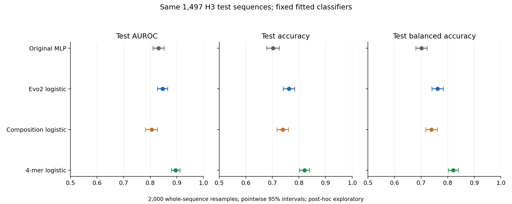
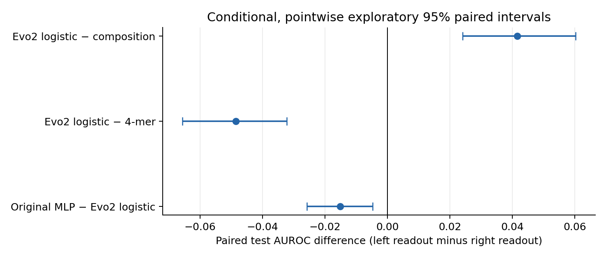
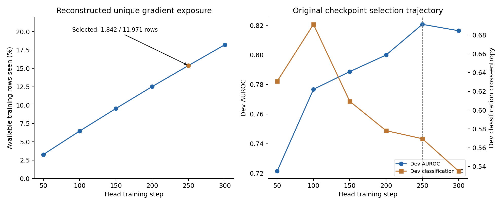

# Benign H3 follow-up results

The 4-mer logistic control outperformed the cached final-normalized Evo2 logistic probe on the supplied test split: AUROC 0.8955 versus 0.8469. The original MLP remains unchanged at 0.8318. This is a post-hoc exploratory study on a test result already known when the supplement was designed, not a new confirmatory benchmark.

## Table 1 — unchanged original MLP, with new conditional uncertainty

| Split | Rows | AUROC [95% interval] | Accuracy [95% interval] | Balanced accuracy [95% interval] | Causal NLL [95% interval] | LM perplexity [95% interval] |
|---|---:|---|---|---|---|---|
| dev | 1497 | 0.8207 [0.7991, 0.8411] | 0.7027 [0.6794, 0.7261] | 0.6998 [0.6782, 0.7213] | 1.2546 [1.2477, 1.2614] | 3.5063 [3.4822, 3.5302] |
| test | 1497 | 0.8318 [0.8097, 0.8519] | 0.7027 [0.6787, 0.7261] | 0.7012 [0.6797, 0.7229] | 1.2557 [1.2492, 1.2629] | 3.5104 [3.4874, 3.5357] |

The selected step-250 head received 2,000 draws from **1,842 unique rows (15.39%)**, not all 11,971 available training rows. At step 300 the unique count was 2,181. All 14,965 rows had frozen features extracted; 11,971 training rows were scored for original training metrics. Those facts do not imply full gradient exposure. See TRAINING_EXPOSURE.md for counts/classes at all six checkpoints and an addendum to the historical wording. The head has 3,696,002 parameters. Limited exposure is a protocol limitation, not an established causal explanation of its score.

## Table 2 — same-row supplemental readouts

| Split | Readout (selected C) | AUROC [95% interval] | Average precision | Accuracy | Balanced accuracy | Classification CE |
|---|---|---|---:|---:|---:|---:|
| dev | Evo2 logistic (10) | 0.8361 [0.8159, 0.8555] | 0.8292 | 0.7615 | 0.7619 | 0.5058 |
| dev | Composition logistic (0.1) | 0.8235 [0.8017, 0.8455] | 0.7651 | 0.7515 | 0.7520 | 0.5322 |
| dev | 4-mer logistic (0.1) | 0.8937 [0.8774, 0.9101] | 0.8893 | 0.8143 | 0.8145 | 0.4177 |
| test | Evo2 logistic (10) | 0.8469 [0.8272, 0.8655] | 0.8268 | 0.7622 | 0.7622 | 0.4920 |
| test | Composition logistic (0.1) | 0.8054 [0.7815, 0.8267] | 0.7269 | 0.7388 | 0.7388 | 0.5572 |
| test | 4-mer logistic (0.1) | 0.8955 [0.8794, 0.9114] | 0.8807 | 0.8210 | 0.8209 | 0.4127 |

Class1 prevalence / majority baseline is 0.5090 on dev and 0.5043 on test. Numeric labels are retained; biological meanings are not guessed. Full sensitivity, specificity, confusion matrices, all accuracy/balanced-accuracy intervals and classification losses are in supplemental_metrics.json, original_metrics.json and uncertainty.json. The composition baseline uses four canonical-base frequencies; 4-mers use normalized overlapping forward-strand counts without RC aggregation. All three logistic pipelines use balanced L2 regression, three identical exact/RC-grouped stratified training folds, fold-local StandardScaler, C=0.1/1/10 with smaller-C ties, and all-train refitting. Solver/seed/tolerance/limits were frozen before scoring. All 27 CV fits and three refits converged without a retry. The Evo2 fit retains float32 cached features/coefficients; sequence controls use float64.

| Paired test AUROC contrast | Difference [95% interval] |
|---|---|
| evo2_norm minus composition | 0.0416 [0.0240, 0.0602] |
| evo2_norm minus 4mer | -0.0485 [-0.0657, -0.0322] |
| original_mlp minus evo2_norm | -0.0151 [-0.0258, -0.0047] |

Every contrast used identical sampled sequence IDs, seed 20261027, 2,000 resamples; none lacked a class. Intervals are percentile, pointwise and unadjusted for multiple exploratory comparisons. Exact/RC groups are all singletons; no biological groups were available, so these intervals do not account for homology or other unknown dependencies. They condition on the fitted readouts and split and exclude fitting/selection uncertainty. Causal NLL resamples entire sequence loss/count pairs; it never treats nucleotide targets as independent. LM NLL/perplexity are reused unchanged for every readout, and classifier CE is kept separate.

The Evo2 probe’s positive difference from composition suggests additional predictive information under this protocol. Its negative difference from the 4-mer control does not establish absent model information or biological mechanism. The original-MLP/readout difference combines changes in architecture, exposure and selection procedure; it does not isolate any one cause. Do not rank this test result against the old block-7 dev score as a model effect.

## Bounded MLP seed sensitivity

| Seed | Selected step | Unique training rows at selection | Dev AUROC | Test AUROC | Test accuracy | Test balanced accuracy |
|---|---:|---:|---:|---:|---:|---:|
| 42 (original) | 250 | 1842 | 0.820656 | 0.831817 | 0.702739 | 0.701179 |
| 17 | 150 | 1152 | 0.805860 | 0.820964 | 0.740815 | 0.740018 |
| 1234 | 250 | 1833 | 0.834328 | 0.840581 | 0.781563 | 0.782086 |

Only the two prespecified additional seeds were run, under a hashed amendment before their test scoring. Every seed is reported; none replaces the original primary result. Their observed test AUROC range is 0.8210–0.8406. Three seeds are not a precise estimate of all training uncertainty.

## Table 3 — readiness for comparison with Sayyed

| Evidence category | Status | Practical conclusion |
|---|---|---|
| Numeric class1 AUROC, MLP definition, actual 300-step/batch8/initial-LR1e-3 settings | VERIFIED MATCH | Specification overlap; not full numerical equivalence. |
| Padding/backend/precision, effective LR curve, checkpoint250 vs300, threshold tie handling | VERIFIED DIFFERENCE | Historical aggregate-score subtraction would mix protocols. |
| Exact split identities, converted base/parent lineage, tokenizer bytes, normalization location, trained head/load audit | UNAVAILABLE | Direct matched H3 comparison is not ready. |

COMPARABILITY.md contains the complete item-by-item matrix. Pinned bionemo head is b90fc1853d1d3be79922a98a2649c91c89716637. Historical H3 logs resolve base iteration 1 and head iteration 300; these files, tokenizer assets and BioNeMo runtime are not available here. No GPU compatibility check, large conversion or build was launched. Missing-head warnings during base loading do not alone prove head-overlay failure; the actual head/load audit is required. The shell continuation error is preserved as executed evidence, and no MaxEnt result is relabeled GradDiff.

## Verification, recovery and next experiment

Five focused accounting tests passed. Independent verification reconstructed all three loaded pipelines and both added-seed heads exactly, checked 2,994 aligned evaluation IDs, fold membership/training-only scaling and selection, independently recomputed AUROC/AP/confusion/CE, and reproduced all 2,000 paired resamples per split via weighted-rank accounting. Maximum bootstrap numeric discrepancy was 4.44e-16. Float32 versus float64 classification-CE differences are explicitly recorded under dtype-based tolerance; no model was refit or metric definition changed in response to test scores. This is saved-artifact verification, not a new backbone reproduction.

The highest-value next experiment is a predeclared training-only token/representation/logit parity check after obtaining Sayyed’s hash-pinned converted base iteration 1, trained head iteration 300, tokenizer/run_config, conversion/loader lineage and split-ID tables. Until then this independent H3 reference supports within-protocol readout/control comparisons, not an unlearning effect or completion of the broader project.

Core classifier/bootstrap execution commit: d64c943ab272120a82c67a04a40da1501cfdcf69. Seed execution commit: 4f1d9c566bf7dcc13e6bf6a87d29392a2b4a1280. Exact code/input/protocol hashes are in the run. Original run is read-only. Run directory: /workspace/meeting-artifacts/sayyed-h3-followup-20261027T001154Z. Packaged source and final documentation delivery commits are recorded separately at delivery. Remote private backup is pending replacement securely configured credentials; the exposed chat token was not reused.

